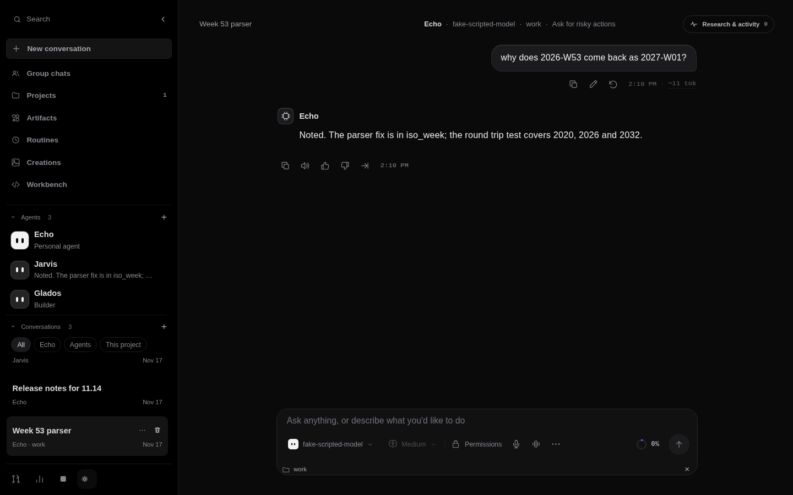

  

EchoSpeak is a local-first AI workspace for research, coding, and creative work. Use a model from Ollama, LM Studio, or a supported cloud provider. EchoSpeak gives it project context, approved tools, persistent sessions, and a record of what it did.

## Downloads

| Platform | Get EchoSpeak |
| --- | --- |
| **Windows x64** | [Download the 11.12.0 installer (.exe)](https://github.com/Ty0x7/EchoSpeak/releases/download/v11.12.0/EchoSpeak_11.12.0_x64-setup.exe) · [MSI and release details](https://github.com/Ty0x7/EchoSpeak/releases/tag/v11.12.0) |
| **Linux x86-64** | [Build from source](apps/desktop/LINUX.md) for AppImage, DEB, or RPM. Version 11.15.0 was built and verified locally. |
| **Terminal** | [Install the terminal client](apps/terminal/README.md) from source and connect it to the shared backend. |

**Latest published installer:** Windows 11.12.0. **Current application baseline on `main`:** 11.15.0. GitHub downloads require repository access. [All releases](https://github.com/Ty0x7/EchoSpeak/releases) · [11.15.0 notes and checks](docs/releases/v11.15.0.md)

*Desktop preview with a scripted test conversation.*

## What you can do

- **Research and create.** Read web sources, save project findings, and preview or revise artifacts alongside the conversation.
- **Work in a project.** Attach a folder, inspect and edit files, run checks, and approve actions that need your permission.
- **Use agents across sessions.** Choose agents with their own instructions and tools, continue across desktop and terminal, and connect supported apps through MCP.

Open EchoSpeak, choose a model in Settings, and use **Test response** before starting a chat. Local models support private workflows. Cloud models and optional network tools send the context needed for the request to the chosen services. [User guide](docs/GUIDE.md)

## How it works

The [React workspace](apps/web) runs in the [Rust/Tauri desktop host](apps/desktop). The [Python terminal client](apps/terminal) and desktop share a [Python backend](apps/backend) for conversations, tools, and approvals. EchoSpeak's agent harness supplies context to the model, checks tool permissions, records results, and tracks verification. [Architecture](docs/ARCHITECTURE.md)

[Engineering workflow](docs/engineering-prompt.md) · [Evaluation system](docs/research/agentic-evaluation.md) · [Issues](https://github.com/Ty0x7/EchoSpeak/issues)

[MIT License](LICENSE)
