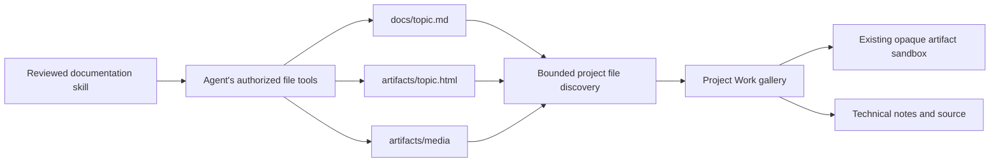
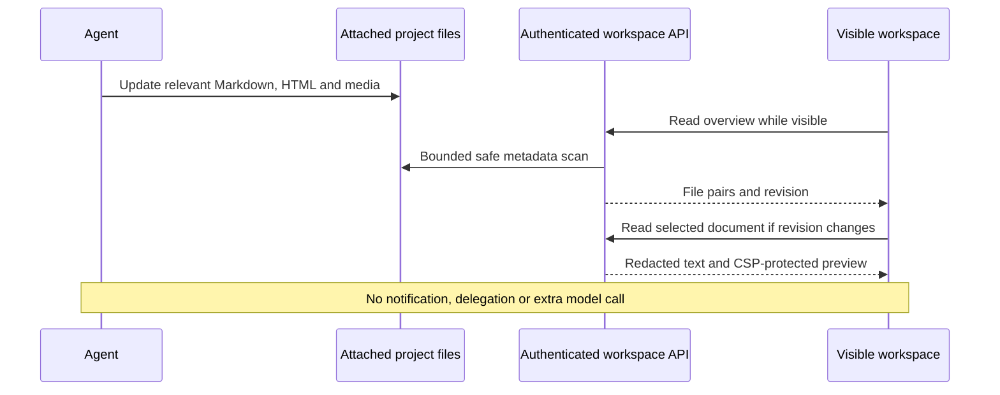

# Project documentation and visual workspace

EchoSpeak discovers actual files in an attached project. Agents keep useful
technical knowledge in Markdown and present meaningful visual results in HTML.
Opening the project shows those files without a manifest, notification, handoff
or additional model call.

## Folder convention

```text
WATCHLIST/
  docs/roads.md
  artifacts/roads.html
  artifacts/media/roads-before.png
  artifacts/media/roads-after.png
  src/
```

Use stable topic names and update existing documents. Matching nested paths
such as `docs/world/roads.md` and `artifacts/world/roads.html` also pair. Markdown
beside HTML is another supported pairing. Unpaired Markdown stays visible.
Source files and original media remain accessible through Files.

Markdown records implementation details, decisions, architecture, source links,
actual verification, limitations and next work. HTML leads with real screenshots,
diagrams, comparisons and concise explanations. It complements the technical
record. Never invent screenshots or verification. Small changes and the end of
a conversational turn do not require new reports.

## Supported agents and skill setup

The canonical portable package is
[project-documentation](../.agents/skills/project-documentation/SKILL.md), with a
self-contained [HTML starter](../.agents/skills/project-documentation/assets/report.html).
It contains instructions and an asset, not an execution system.

| Agent | Setup | Actual loading behavior |
| --- | --- | --- |
| EchoSpeak | Settings → Skills → Project documentation → Add for review → review and Approve | Only approved, hash-pinned skills are offered. `read_skill` loads details when needed. Project skills are never silently trusted. |
| Codex | Full package in `.agents/skills/project-documentation/`; short convention in existing `AGENTS.md` | Skill metadata discovery is separate from layered AGENTS instructions; full skill content loads when selected. |
| Claude Code | Full package in `.claude/skills/project-documentation/`, or this repository's small wrapper plus canonical package; short convention in existing `CLAUDE.md` | Claude's documented project skill path is `.claude/skills`. Do not assume direct `.agents/skills` loading. |
| OpenCode | Canonical `.agents/skills` package and existing `AGENTS.md` | Also supports `.opencode` and Claude-compatible skill paths. Skill permissions/configuration can restrict access. |

Copy the entire skill folder, including assets, when adopting it elsewhere. The
Claude wrapper requires the canonical `.agents` package too. Keep one detailed
authoring body. Avoid redundant full copies across all discovery locations;
OpenCode can encounter both supported paths. Other agents need their own
documented discovery/permission checks.

Merge this short convention into the appropriate existing project instruction
file rather than replacing its other instructions:

> After meaningful completed work, use project-documentation when technical
> Markdown and visual HTML both add value. Read its SKILL.md, update relevant
> topic documents, preserve user changes and record only checks performed.
> Small changes do not require new reports.

EchoSpeak does not write configuration into attached projects, change global
agent settings, install hooks or override another harness. In EchoSpeak,
`project_workspace` discovers/reads documents within the conversation's attached
project. Outputs remain untrusted evidence. `save_project_image` preserves an
original screenshot observation from this chat in `artifacts/media/`, with
file-write permission and normal tool policy. It rejects another chat's images
and conflicting existing files. Other agents use their existing authorized tools.

## Workspace experience and refreshing

Work is a single gallery of HTML/Markdown and native Echo artifacts. Matching
technical Markdown opens through Technical notes beside the HTML preview, rather
than a duplicate card. Project creations remain below with their existing library
link. Files, Conversations, Research, Routines and Activity preserve existing
project associations. Earlier imported reports are available in a collapsed list.

HTML opens in a large sandboxed preview with Source access. Thumbnails use actual
local images or static HTML with scripts disabled. Original images can be viewed
and saved through Files. The app's existing theme tokens style the workspace.

The visible workspace refreshes every five seconds and when focus/visibility
returns. Failed requests retain the last good state and show the error. Metadata
revisions detect additions, edits, deletion and media changes; open documents
refresh on a changed revision. Closing the workspace stops its timer. No OS
watcher, persistent scan database, personal-memory write or model call is involved.

## Architecture





## Security and bounds

Routes retain the existing local API authentication guard. Paths stay inside
the attached project. Traversal, absolute paths, links/junctions, private dot
folders, secret/key files, Windows device names and trailing-dot/space aliases
are rejected. Legacy `.echospeak` files remain explicitly readable but are
excluded from discovery. Documentation never acquires execution authority.

HTML reuses `artifacts.frame_html` and its CSP inside an opaque iframe without
same-origin permission and with scripts disabled for project-file previews. Non-fragment links and meta refresh navigation are removed; open technical notes and source through the surrounding controls. Native Echo artifacts keep their existing interactive viewer. Network fetches, remote scripts/styles, forms, nested
frames and parent-app access stay blocked. Only validated relative local raster
images, video and audio are embedded, with an 8 MiB aggregate budget. Use inline
CSS and inline SVG/CSS diagrams. Large media, external assets and bundler-based
web apps are not supported report dependencies. Original media remains available
separately through Files.

Scans visit at most 6,000 entries, seven nested levels and 200 documents, with a
350 ms enumeration budget. Conventional docs/artifacts/reports folders are
prioritized among root folders. Generated/private trees are skipped. A limited
scan is indicated; Files remains available beyond the gallery selection. Folder
listings return up to 300 supported entries from bounded enumeration. Text
previews are limited to 380,000 bytes; media reads to 64 MiB. Revisions use mtime
and size, so edits deliberately preserving both can be missed until another
change or reopening. This is bounded discovery, not a complete repository index.

## Earlier data and cleanup

Removed: manifest publisher, lifecycle receipt helper, sharing/export/sync
controls and mutation routes, and the offered `save_project_report` tool.
Historic report-write timelines retain their bookkeeping classification.

No project files, `.echospeak` directories, records, conversations or artifact
versions are deleted or migrated. Earlier report revisions stay readable, and
their linked artifacts are excluded from the main gallery to avoid duplicate
cards. Existing external hooks remain the owner's independent configuration;
remove obsolete helper calls manually if previously configured. EchoSpeak no
longer requires or consumes those receipts. Old release notes remain historical.

## Research findings

Reviewed on 2026-10-18. Shared instructions are portable, but discovery,
invocation and trust differ. Real agent behavior still needs user evaluation.

* Codex documents `.agents/skills` discovery and progressive loading, separately
  from layered project instructions. [Skills](https://developers.openai.com/codex/skills),
  [AGENTS.md](https://developers.openai.com/codex/guides/agents-md).
* Claude Code documents `.claude/skills`, invocation controls and CLAUDE.md
  context. [Skills](https://code.claude.com/docs/en/skills),
  [project memory](https://code.claude.com/docs/en/memory).
* OpenCode documents compatible skill paths, permissions and project rules.
  [Skills](https://opencode.ai/docs/skills/), [rules](https://opencode.ai/docs/rules/).
* Mr. Mak was inspected at commit `94c0d282da48597cde07440bf88e0b1318c6721b`.
  Its workspace-authoring skill encourages genuine media, shared styling,
  responsive reports and updating existing work. `desktop/service/workspace.mjs`
  reads a registry; `src/lib/workspace.ts` polls while visible and retains good
  state on errors. EchoSpeak adopts those presentation/refresh principles with
  direct file discovery. No coordinator, runtime or report assets were copied.
  [Pinned source](https://github.com/witnesstodark/mr-mak-workspace/tree/94c0d282da48597cde07440bf88e0b1318c6721b).

## Implementation map

* `apps/backend/agent/project_workspace.py`: scoped discovery, pairing, file
  access, local media embedding, current-document reading and screenshot export.
* `apps/backend/api/routes/project_workspace.py`: read endpoints.
* `apps/web/src/projects/`: gallery, thumbnails, previews and visible refresh.
* `agent/lean/agent_skills.py`, `api/routes/lean.py` and frontend
  `settings/AgentSkillsSection.tsx`: explicit optional skill import/review.
* `.agents/skills/project-documentation/`: canonical package; `.claude/skills/`
  contains a thin adapter. Root AGENTS.md/CLAUDE.md hold only the short convention.
* `apps/desktop/backend/echospeak_backend.spec`: bundles canonical skill assets.

## Verification and limitations

The corresponding [visual report](../artifacts/PROJECT_WORKSPACE.html) records
verification and screenshots of the implemented UI using isolated fixtures.
Tests cover file discovery/pairing, refresh detection, privacy/bounds, earlier
data/deduplication, API authentication, media ranges, scoped screenshot export
and skill review. Type checking, existing frontend tests and a production build
also passed. There are no automated live-agent or paid-provider calls.

Real agent authoring, large real projects and the installed/packaged Windows app
still need user evaluation. Active app sessions were not restarted. Source
version remains 11.9.2; this workflow change does not publish a new installer.
