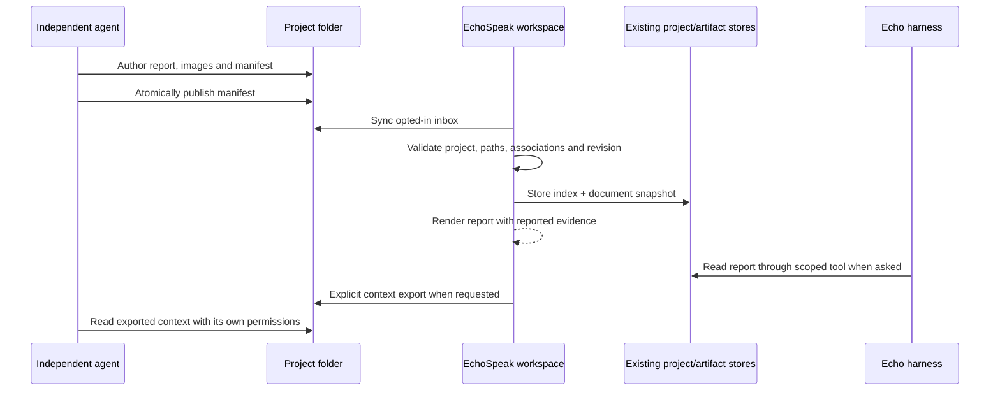

# Project workspaces and independent agent handoffs

Projects now open a visual workspace, rather than choosing or creating a conversation automatically. Conversations remain available in the project, with their existing context and background execution.

## Using the workspace

* **Reports:** descriptive work records, document revisions, linked images/video, changed files, reported verification and remaining tasks. Open an image at original resolution or save it. Save a report as Markdown/HTML.
* **Files:** bounded browsing and read-only previews of supported project files. Markdown uses EchoSpeak's existing code, table and diagram renderers. HTML uses a sandbox. This is not an unrestricted filesystem browser or an automatic development server.
* **Conversations:** existing chats attached to this project. New project chat creates a new session only when requested.
* **Research:** explicitly saved project findings and links back to chat notebooks. Temporary notebooks keep their existing retention; nothing is promoted into personal memory.
* **Artifacts:** the existing artifact catalog and version histories, opened through the shared right panel. While browsing a project, that panel does not expose an unrelated active chat's research or activity.
* **Media:** project-associated generated images/videos from the existing media library. Report screenshots remain linked project files; they are not duplicated into Creations.
* **Routines and activity:** existing explicit project/session associations. Viewing them does not start a routine or agent.

## Preparing a shared project

Open a project, expand **Sharing**, and choose **Prepare shared folder**. This requires Allow actions on this computer and Create and edit files in Permissions.

Preparation creates these files under the attached folder:

```text
.echospeak/
  project.json                 Project identity binding
  README.md                    Sharing convention
  project_handoff.py            Portable publisher / optional receipt hook
  handoffs/                    Finalized report manifests
  events/                      Optional lifecycle receipts
  context/workspace.json       Created only by Export project context
```

The helper is packaged as backend resource data for desktop builds, as well as available through `scripts/project_handoff.py` in the repository. It requires Python in the external agent's environment. Manual JSON import works without that helper.

Preparation does not install hooks, replace AGENTS.md or CLAUDE.md, change another agent's settings, or grant tool permissions. Existing custom helper/instruction files are preserved. A folder already bound to a different project is rejected. Disable sharing to stop automatic inbox sync; existing reports and files remain.

**Export project context** explicitly writes the brief, saved research, work index and bounded artifact contents into `context/workspace.json`. Agents read that file through their own approved file tools. No conversation transcripts, model configuration, global memories or credentials files are exported. Known configured secrets are redacted; review documents before sharing a project with someone else. Generated media stored outside the project is not automatically copied into it.

Export is a snapshot. Export again after meaningful changes. It does not enable automatic inbox sync when sharing is off. Its contents are evidence, not additional project instructions.

## Publishing a meaningful report

Read `.echospeak/project.json` for the real project ID. Author a clearly named report and use paths relative to the attached project folder. Example:

```json
{
  "schema_version": 1,
  "project_id": "COPY-THE-ACTUAL-PROJECT-ID",
  "id": "city-roads",
  "revision": 1,
  "title": "City Roads — Layout Improvements",
  "summary": "Connected the road junctions and documented remaining collision checks.",
  "agent": "claude-code",
  "session_id": "external-session-id",
  "status": "in_progress",
  "report": "reports/city-roads/report.md",
  "files_changed": ["src/roads.gd"],
  "media": [
    {"path": "reports/city-roads/before.png", "caption": "Before"},
    {"path": "reports/city-roads/after.png", "caption": "After"}
  ],
  "verification": [
    {"label": "Scene test", "result": "not_run", "evidence": "Godot gameplay requires the owner's test."}
  ],
  "remaining": ["Check collisions in the running game"]
}
```

Save the manifest as `reports/city-roads/manifest.json`. From the project root:

```powershell
python .echospeak/project_handoff.py --project . --manifest reports/city-roads/manifest.json
```

The repository equivalent is:

```powershell
python scripts/project_handoff.py --project "C:/Projects/WATCHLIST" --manifest reports/city-roads/manifest.json
```

The publisher writes one stable inbox file atomically. EchoSpeak imports it when the workspace opens, on a visible 30-second refresh, or when **Sync reports** is clicked. Closed projects do not run a background watcher. **Import report** also accepts a manifest selected manually; referenced files must already be inside the selected project.

Use `agent` values `echo`, `claude-code`, `codex` or `other`. Status is `completed`, `in_progress`, `blocked` or `interrupted`; it is always a reported status. Verification results are `passed`, `failed`, `not_run` or `unknown` and should include actual evidence. Optional `source_commit` records a reported Git commit. `artifact_ids` and `related_records` link existing work. `echo_session_id` may link an actual Echo conversation, but only if attached to this project. An external session ID never becomes an Echo session link automatically.

Keep a stable ID for related revisions and increase revision when changing content or claims. Duplicate imports do not create extra artifact versions. Older revisions cannot overwrite newer work. Changed content with the same revision is rejected. Partial or invalid files remain errors for retry without erasing the last good report. Imported document snapshots reuse artifact storage; the report index remains in the existing project record.

Echo's core toolset also includes `project_workspace` to search/list/read reports with continuation offsets, and `save_project_report` to document authorized work directly. The tools derive project identity from the bound conversation, rather than trusting an arbitrary project ID from the model. Saving a report does not export shared context or start another agent. Optional `observation_ids` preserve up to three original screenshots from the current chat inside `.echospeak/media/`, with file-write permission; other chats' images are rejected. These intentional report copies survive the temporary screenshot store's expiry.

## Optional lifecycle hooks

Hooks are optional receipts, not report authors. A stopped turn, rate limit or interrupted session cannot establish task completion. The helper copies only agent/session/turn/event identifiers and an observed timestamp into `events/`; it does not copy assistant messages, API error details, transcript paths or credentials. Receipts never become user-facing work reports or trigger follow-up reasoning. It retains up to 200 generated receipts and fingerprints duplicate events when the host supplies no turn ID.

For supported, trusted project hooks, merge this example into the agent's existing configuration after reviewing it. Adjust paths and the Python command for your machine. Do not replace existing configuration.

Claude Code `.claude/settings.json`:

```json
{
  "hooks": {
    "Stop": [{"hooks": [{"type": "command", "command": "python \"C:/Projects/WATCHLIST/.echospeak/project_handoff.py\" --project \"C:/Projects/WATCHLIST\" --agent claude-code --hook", "timeout": 10}]}]
  }
}
```

Codex `.codex/hooks.json` uses the same Stop handler, with `--agent codex`. Confirm support and trust review in your installed version. The helper returns `{}` and never asks an agent to continue. Claude Code StopFailure and Codex Interrupt can use the same helper to record interruption receipts; only configure events supported by your version.

For Codex versions using the legacy notification mechanism, merge this into the appropriate config layer instead:

```toml
notify = ["python", "C:/Projects/WATCHLIST/.echospeak/project_handoff.py", "--project", "C:/Projects/WATCHLIST", "--agent", "codex", "--hook"]
```

The appended JSON notification is handled separately from hook stdin. Configure one notification route to avoid duplicate receipts. No hook-to-Echo API connection or API-key distribution is needed. Hooks are not installed or live-tested automatically by this change.

Official references: [Codex instructions](https://developers.openai.com/codex/guides/agents-md), [Codex hooks](https://developers.openai.com/codex/hooks), [Codex legacy notifications](https://developers.openai.com/codex/config-advanced#notifications), [Claude Code hooks](https://code.claude.com/docs/en/hooks).

## Security and limits

Imports are untrusted project evidence. They cannot set permissions, execute commands, update project instructions, import permanent memories or establish independently verified learning. Report read/save bookkeeping is excluded from learning verification evidence. Reading a report participates in the harness's existing untrusted-content policy and approval rules.

Absolute paths, traversal, symlinks/junctions, protected folders and common credential files are rejected. Referenced artifacts and Echo sessions must belong to the selected project. API reads keep the normal authentication guard. Media uses authenticated fetches and temporary browser blob URLs; there are no public media URLs or embedded API keys.

Limits are deliberate: 64 KB manifests; approximately 380 KB UTF-8 document previews; 64 MB media previews; 100 recent inbox manifests per sync; 300 displayed entries per directory; 1000 reports per project; 20 report metadata revisions and the artifact store's existing 50 content versions. Clear excess processed inbox files or import older manifests manually. Preview limits do not delete source files.

HTML uses the existing artifact sandbox, without same-origin access. External styles, scripts, frames and fetches are blocked by its CSP. Up to 2 MB of project-local raster images are embedded when rendering HTML reports; larger images should be listed in the gallery. Self-contained interactive previews fit this boundary. External websites open through safe links; running a development server remains an explicitly governed tool action. PDF/Office/3D previews are outside this change.

Document content is snapshotted; linked media and changed files reflect their current project files. Preserve versioned asset filenames when comparing revisions. Imported status and source commits do not detect every later filesystem change. Older artifacts without project IDs are associated through existing session scope; moving old sessions between projects can make historical provenance ambiguous.

## Architecture and evaluation



Source-backed research and alternatives are in [Project workspace engineering findings](research/project-workspace.md). Implementation centers on `agent/project_workspace.py`, `api/routes/project_workspace.py`, `agent/projects.py`, existing artifact storage, `apps/web/src/projects/`, and the existing dashboard and shared panel.

Manual evaluation:

1. Open an existing project and confirm it lands in the workspace. Switch to another project while a chat is running; return to the original conversation and confirm continuity.
2. Prepare sharing in a disposable project. Publish a real report with screenshots using the manifest convention. Confirm its name, original images, source links and honest verification labels.
3. Increase revision, update the report and sync. View the previous revision. Retry a duplicate, older revision and partial JSON file; confirm the last good report survives.
4. Open existing artifacts and their history, explicitly saved research, project conversations and associated creations/routines. Check narrow layouts and both themes.
5. Ask Echo in an attached project chat to explain the report and outstanding work. Test your chosen local/cloud model manually. Ask it to save its own report, then explicitly export project context and read it with another agent.
6. If desired, configure one official hook. Confirm it writes a receipt only and never generates a completion report or starts another agent. Test interruptions using that agent's normal controls.

No paid/live model tests, independent-agent runs, real project migrations or installed-app restarts are required for the automated checks. A new desktop build and real-agent/manual evaluation remain necessary before release distribution.
