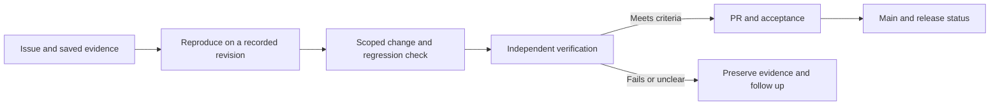

# EchoSpeak Evidence-Driven Engineering Cycle

**Discover → Research → Reproduce → Issue → Implement → Verify → Compare → PR → Acceptance → Main → Release or install when required → Preserve → Cleanup → Continue.**

Claude Code and Codex use this cycle for EchoSpeak development, each with its own tools and approvals. Echo Native applies the same stages inside its execution loop. See the [verified-engineering report](research/verified-engineering.md).

Start substantial work by checking the branch, worktree, Git status and acceptance criteria. Read the latest relevant Claude and Codex session records alongside the code, engineering reports and Obsidian notes. Check which findings still reproduce on the target revision and which fixes have already landed. Choose the loops that answer the open questions. For a small change, the objective and a direct check can fit in one sentence.

## Start an engineering task

Open the EchoSpeak repository in Codex or Claude Code. Give the desired outcome or the GitHub issue, one way to tell whether the work succeeded, and the stopping point. Here are three requests you can use as written.

- **Evidence review:** “Review EchoSpeak issue #121. Start with the saved LT1 trace and the recorded release revision. Tell me what ran, what the verifier counted, and which regression test would catch the difference. Update the issue with evidence.”
- **Scoped fix:** “Work on EchoSpeak issue #121. Reproduce the false negative and add a failing-first test. Verify the fix also rejects commands that only print test-like output. Use one worktree and open a PR with the results. Stop at review.”
- **Bounded campaign:** “Run one local EchoSpeak improvement cycle for issue #122. Compare the saved partial run with a successful one first. Keep the model, context and budgets comparable, and report the outcome on the issue. Use local inference and either a verified subscription driver or a manual fix.”

The engineering agent reads this workflow and checks local notes, run artifacts, existing patches and issues before rerunning anything. A deterministic replay or a targeted test is usually the first check. A live model run is useful when the open question concerns model behavior, tool choice or end-to-end reliability.



GitHub holds the task, patch and shareable evidence. Obsidian holds the local timeline and links to the artifacts. A worktree is a separate local checkout for the task. The controller runs isolated evaluations and records each decision. The engineering session uses that evidence to prepare the PR. Merging updates source on `main`. Building, installing and confirming a release are separate recorded actions.

For a controller-assisted effort, use a scoped checkout with the backend environment ready. Use the session directory returned by the controller for review or stop. New runs use `run --issue NUMBER` and explicit bounds. Resume an approved pending fix with `run --resume --session PATH`. Read [the controller operating guide](research/agentic-evaluation.md#11-operating-the-system) for the commands and [the workspace audit](research/workspace-governance.md#follow-up-evidence-inventory) for existing evidence to reuse.

When an existing regression goes red, record the exact failing test ID and reproduce the behavior through the normal entry point. If a fixture skipped registration or current-message authorization, repair the setup and retain the original behavior checks. Record fixture maintenance separately from product fixes and model scores. A bounded model cycle can reach its target while still reporting advisory checks. Preserve those diagnostics with the cycle evidence.

## Thirteen engineering loops

| Loop | When and how to use it |
|---|---|
| 1. Engineering Loop | Define the outcome, research existing behavior, inspect the environment, establish a baseline, adapt from evidence and verify completion. |
| 2. Agent Execution Loop | Understand the next action, select a tool, execute, observe the result and verify whether to continue or stop. |
| 3. Harness Optimization Loop | Establish a baseline, run a real model, capture the trace, judge independently, diagnose the cause, improve the harness and retest under comparable conditions. |
| 4. Verification Ladder | Use the existing V0–V4 evidence levels and independent scoring. Trace a completion claim to the tool result, artifact, rerun or owner acceptance that supports it. |
| 5. Regression Loop | Reproduce the defect, observe a focused test fail, fix the cause, rerun the test and check affected behavior. |
| 6. Architecture Review Loop | Inspect the component and its callers, research alternatives, then decide whether to keep, upgrade, replace or remove it. Verify the decision against its existing responsibilities. |
| 7. Security & Environment Loop | Identify trust boundaries, check permissions and isolation, exercise the relevant allowed and denied paths, and verify that any fix preserves approvals and sandbox boundaries. |
| 8. Skills & Learning Loop | Propose a skill, rule or lesson, run a controlled experiment and compare with the baseline. Retain or discard it based on observed behavior. |
| 9. Delegation Loop | Give each delegate a bounded task, relevant context and an acceptance check. Verify returned evidence before integrating the work. |
| 10. Conversation Audit Loop | Inspect recent real sessions, trace behavior to execution records, reproduce the defect, fix its cause and replay the relevant case. |
| 11. Knowledge Preservation Loop | Record decisions, checks and limitations in the relevant project document and Obsidian note. Link evaluation results from the existing vault index so later work can reuse them. |
| 12. Release & Acceptance Loop | Verify, commit and back up the change, integrate when authorized, then build, install and record owner acceptance when it occurs. |
| 13. Autonomous Engineering Loop | Orchestrate bounded, repeated improvement cycles. An engineering agent (Claude Code, Codex, later EchoSpeak) fixes what independent evaluation measured; only evidence keeps a change. Use `apps/backend/scripts/auto_test_fix.py` and the [auto-test-fix skill](../.agents/skills/auto-test-fix/SKILL.md). The evaluation layers are in [agentic evaluation](research/agentic-evaluation.md). |

## From finding to accepted change

1. **Discover and record.** Inspect the current revision, relevant session evidence, existing issues (open and closed), PRs and the [20-system harness review](research/harness-architecture-2026-11.md). Name the affected systems and their callers. Reproduce the symptom against the baseline. Update the existing issue or open one confirmed, actionable issue with the environment, safe reproduction, expected/observed behavior, affected components, known cause or hypothesis, and measurable acceptance criteria. Keep private prompts, credentials, user data and raw session logs local.
2. **Work on one effort.** Fetch main and record its SHA. Use one scoped branch and temporary worktree for the issue. Prefer `~/Work/echospeak-worktrees/<issue>-<topic>` for new manual efforts. The controller's own `auto/<session>` tree serves this role during an evaluation; pass `--issue NUMBER` on a new run. Preserve existing work when resuming. Check open work before starting a duplicate. Record the issue, owner, branch, tree and base in the issue or campaign record.
3. **Fix and compare.** Exercise the failure first, change its cause, repeat the check, then exercise adjacent behaviors and at least one independent criterion. Record the tested SHA and before/after results, including losses. Use the native evidence ladder: V0 claimed, V1 observed tool success, V2 checked after the final change, V3 corroborated by two kinds of checks or independent sources, V4 confirmed by the owner. Record actual owner acceptance separately. Use only verified subscription-backed engineering clients or local models. Stop on exhaustion or uncertain billing. Preserve the sandbox, permissions and held-out evaluation boundaries.
4. **Propose.** The outer engineering session handles GitHub for the campaign. The bounded driver keeps its existing scoped tools. Use `review --session <dir> --github` for a local Markdown draft of the issue reference, decisions and before/after scores. Inspect full local evidence with ordinary `review`. Review the diff for private content and link redacted findings to the issue. Push the scoped branch normally and open one PR to main with `Closes #N`, reproduction, cause, before/after measurements, independent checks, compatibility, limits, and release/install impact. Use `Refs #N` for partial fixes. A rejected arm belongs in the issue history with its result and the evidence needed to reproduce it.
5. **Accept.** Integrate through a PR when authorized to merge, the diff is in scope, required checks pass on the reviewed head, the independent evidence meets the issue criteria, and required reviewers have approved. Inspect conflicts and rerun affected checks if either base or head moves. Pin the merge to the reviewed head (for example `gh pr merge N --merge --match-head-commit SHA`). A security-boundary change, disputed measurement or owner-only acceptance criterion needs owner review. Verify the remote merge SHA, check issue closure and track residual defects separately.
6. **Close out.** Record evidence in the issue, PR, relevant research note and vault index. Confirm whether release and installation are required and separately authorized. Use `auto_test_fix.py reconcile --session PATH --pr NUMBER --reviewed-head SHA` to read and bind the GitHub checkpoints to the session. After integration, provide an owner-attested `--evidence FILE` JSON record with `issue`, `pr`, `head`, `merge_commit`, `issue_update`, `technical_record`, `obsidian_record`, and `release_status` (`installed_verified` or `not_required`). Preserve rejected and blocked results alongside their evidence. Distinguish source-only work, packaged checks, deployment and personal acceptance.
7. **Continue.** Reconcile existing work before duplicating it. If one task waits for approval, choose independent authorized work from the bounded issue queue. Use `auto_test_fix.py continue --issues N M` to select an open issue. Add `--start` to begin one cycle with the existing driver under its budget and billing checks. Keep the legacy cleanup proposal in issue #120 outside routine engineering queues.

## Preservation and retirement

- Routine retirement applies only to the named effort's temporary resources. Check the exact branch SHA against remote main (or prove patch equivalence for a squash/cherry-pick), clean index and working tree, untracked **and ignored** files, outstanding stashes, linked sessions and runtime/build dependencies. Preserve unique changes, test outputs and recovery information first. Record the checks and scope in the PR. A clean porcelain status alone misses ignored data.
- For `installed_verified` in a closeout receipt, include `installed_revision` and `release_record`. The controller checks that the installed revision includes the accepted merge and is reachable from main.
- The controller accepts `--retire` only for its own recorded, clean, merged local worktree and branch after accepted evidence is preserved. It checks reachability against current remote and local main, the exact PR head, worktree identity and running process directories. Only its exact dependency symlinks can be removed before ordinary Git worktree retirement. Review ignored evidence, linked sessions and runtime dependencies before invoking it. GitHub publication, merge, install and legacy cleanup remain outer-session decisions under the existing approval policy.
- **Explicit owner approval naming the scope is required for bulk branch deletion, force pushes, destructive resets, or removing unique work.** A cleanup plan, archive, tool permission or request for organization does not authorize those actions. Leave existing worktrees awaiting owner cleanup approval. An unsuccessful cycle with edits stops for review. Inspect partial changes before starting follow-up.
- **Git history.** Use main and its normal remote as the working baseline. Before an exceptional retirement, inventory full ref names and OIDs and relevant stashes, save a verified bundle only where existing copies do not cover unique history, and test recovery in an empty repository. Verify the manifest and reachability of each ref. Preserve any uncommitted files and ignored evidence separately. The existing 11.15 archive and restore procedure are in the [workspace audit](research/workspace-governance.md).
- **User data.** Keep private backups outside Git with owner-only access. Before a migration or release, identify the actual data directory and check active work. Use a quiescent snapshot or SQLite's online backup for live databases and coordinate the remaining files at the same boundary. Include chats, project metadata, memory, settings and agents, and account for credentials separately. Verify a private isolated restore with SQLite integrity checks and representative record/file comparisons. Store an encrypted recovery copy on owner-controlled independent storage when available. Reuse a current verified backup; rotate only after its successor passes a restore check.

## Model evaluations and handoff

### Formal proof obligations

Architecture and security review choose a concrete invariant, its production boundary, and which state transitions it covers. For changes to canonical memory visibility, run the normal Python regressions and `tools/formal/check.py` using the pinned local Lean 4 toolchain. The controller runs this additional gate after the Python checks for changes to `agent/memory.py`. Missing tooling or an incomplete proof blocks that obligation.

The gate checks the named statements, audits allowed axioms, replays the compiled proof through the kernel, and compares the production predicate with Lean-generated decisions. Record the theorem, assumptions, a negative control, and the separate runtime results. Use the existing V0–V4 ladder for the complete application claim. [Formal verification and the optional proof tool](research/formal-verification.md)

Reuse the native harness, execution loop, permissions, sandbox, delegation, skills, memory and provider integrations. Start with existing regression tests, conversation evidence and architecture reviews. A change to the architecture or prompt needs a demonstrated cause and a measurable improvement.

For a model evaluation, use Qwen 3.5 9B (`qwen3.5:9b`) as the reference unless the owner specifies otherwise. Use the existing campaign runner, model recorder and independent judge. Weight completion **30%**, tool execution **25%**, efficiency **20%**, recovery **15%** and security **10%**. Report failures, security findings and regressions alongside the score. Choose cases that exercise the behavior being changed. See the [model-harness-testing skill](../.agents/skills/model-harness-testing/SKILL.md).

At handoff, name the change and its cause, record the baseline and final checks with their outcomes, and identify remaining limitations and the steps ready for owner testing. Preserve user data, conversations, credentials and existing work. Pushing, merging, publishing and destructive operations require authorization.

Record the release and installation state separately. A passing baseline starts an investigation; a reproducible defect calls for a justified fix and a post-change check.

**Hill climbing, in one line:** define the target, measure a baseline, try an improvement, verify it, keep the best result, and stop when the target is met or progress stops. It is a disciplined way to measure progress and know when to stop or ask. It doesn't promise the optimum, and it isn't "repeat until it works".

## What goes where

| Layer | Put here | Don't put here | In this repo |
|---|---|---|---|
| **Repository instructions**: loaded every session, always true | Build and test commands, conventions, boundaries ("never merge or publish"), test policy ("targeted tests only"), environment facts | Task goals, one-off decisions, long procedures | `CLAUDE.md` (Claude Code), `AGENTS.md` (Codex), project instructions (Echo, via `home.instructions_section`) |
| **Skills**: loaded when a class of task needs them | Reusable procedures with their own checks: documentation, releases, reviews, a deploy | Facts every task needs (those belong in the repository instructions); this task's goal | `.agents/skills/*`, Claude Code skills, Echo's approved agent skills |
| **Task prompt**: this one task | The objective, acceptance criteria, the check, constraints, stop conditions | Repeating repository instructions; step-by-step implementation | The template below |

Keep repository instructions short: every line is paid for on every request, and a long file buries the rules that matter. If a rule only applies to one kind of task, it belongs in a skill.

## The template

Copy it, delete the sections that don't apply, and keep each section to a few lines.

```text
OBJECTIVE
What should be true when this is done, in user terms: <outcome>.
Acceptance criteria (verifiable):
- <criterion 1>
- <criterion 2>
Needs human judgment (not checkable by a command): <e.g. visual polish, wording> - or "none".

RESEARCH
Read first: <files, docs, PRs, prior reports>. Prefer primary sources and the actual code over assumptions.
Depth: <light | substantial>, in proportion to the task.

ENVIRONMENT
Available: <runtimes, test tools, services, credentials that already exist>.
Not available / not allowed: <paid services, new permissions, network, merging, publishing>.
If something essential is missing, say exactly what and stop. Don't work around a permission.

VERIFICATION
Check: <the command(s) that decide success, e.g. `pytest -q tests/test_parser.py`>.
Baseline first: run the check before changing anything and record the result.
Metric (optional, for improvement work): <name> <lower|higher> is better, target <value>.
Correctness guard: <the tests that must keep passing while the metric improves>.
Never weaken a check, edit tests to pass, or redefine the objective to fit a result,
unless the task is to change the tests.

ADAPTATION
After each attempt, compare against the best result so far. Use the evidence (expected vs actual,
failing tests, errors), not a guess. If it got worse, return to the best state. If several attempts
haven't improved, change hypothesis or report the blocker. Don't retry variations of the same fix.

COMPLETION
Stop when the check passes (and the target is met), when the owner approves a judgment call,
or when a blocker needs the owner. Report:
- what changed, and where
- verification evidence (commands and their results)
- what isn't verified, and remaining uncertainty
- blockers, and what would unblock them
Partial completion is reported as partial.
```

### Small tasks: three lines

> Fix the off-by-one in `paginate()` (`api/pages.py`). Done when `pytest -q tests/test_pages.py` passes; don't touch other tests. Report the diff and the test result.

If the objective, the check and the stop condition fit in one sentence, the full template is overhead.

## Per harness

The template is the same everywhere. Each harness keeps its own loop, tools, models and approvals.

- **Claude Code.** Repository rules live in `CLAUDE.md`, and procedures in skills. Put the template in the task message. Plan mode suits the Research stage of large work. Claude Code runs the checks with its own tools. Ask for targeted tests by name; the repository instructions already say not to run full suites.
- **Codex.** Repository rules live in `AGENTS.md`. The template goes in the task, and the Environment section should state the sandbox and approval mode the run has. Codex's own runtime executes. EchoSpeak doesn't change it.
- **Echo Native (Agents and Code).** The Objective and Verification sections map onto `set_objective` (objective, criteria, check, metric). EchoSpeak then measures every check. It sends back progress against the baseline and the best result, the failing tests and first error, regressions and stalls, and the bottleneck class, attached to each check's result. Completion is computed from that evidence and shown under the answer: verified, checks pass, partly verified, failing, not verified or blocked. Echo calls `set_objective` itself for substantial work; you can also give the template in the message.

## Example: an optimisation with a correctness guard

```text
OBJECTIVE   Make `parse_log()` faster on large files without changing its output.
            Criteria: mean time on bench/large.log under 100 ms; all parser tests pass.
RESEARCH    Read parser/log.py and its tests; check how the file is read (I/O vs regex).
ENVIRONMENT Python 3.12 venv in .venv; hyperfine installed; no network needed.
VERIFICATION Baseline: `hyperfine "python bench.py"` and `pytest -q tests/test_log.py`.
            Metric: mean, lower is better, target 100 (ms). Guard: tests/test_log.py stays green.
ADAPTATION  Keep the fastest version that passes the tests. If a change breaks the tests, undo it first.
COMPLETION  Report baseline vs final timing, the test result, and what was tried and dropped.
            If 100 ms isn't reachable, report the best verified result and why.
```

## Anti-patterns

- **"Keep going until it works."** There's no measure and no stop. Give a check and a stop condition.
- **Prescribing the implementation.** It closes off better solutions. Say what must be true; leave the how to the agent.
- **Vague success** ("make it better"). Name a check, or say the outcome needs the owner's judgment.
- **Letting the check move.** Changing the tests, the benchmark input or the objective to fit a result is reward hacking.
- **Optimising only against known fixtures.** Include a check the agent didn't write, or an independent one such as real data, a build, or the owner's eyes.
- **Hiding partial work.** "Done" with failing checks is worse than "3 of 4 criteria verified; the fourth is blocked by X".
