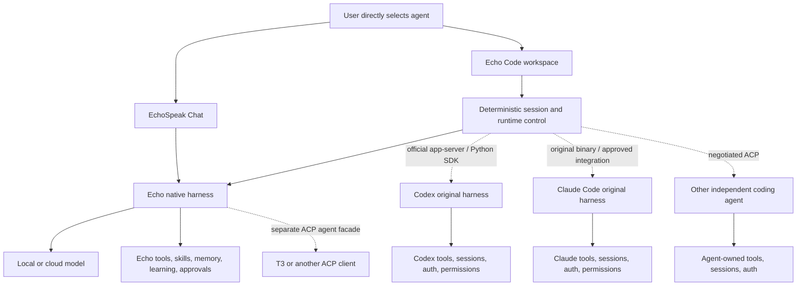

# Echo Code: architecture, integration research, and foundation

Research date: **2026-10-25 UTC**. EchoSpeak checkout: `claude/security-audit`, package version `11.10.3`, with unrelated work already present. This is a source implementation and research record, not a release or an installed-app acceptance report. Visual companion: [Echo Code review](../../artifacts/research/echo-code.html).

**Current runtime implementation — 2026-10-25:** phases 2–5 below are implemented on `codex/echo-code-runtimes`, based on the pending UI PR #95. The earlier foundation/package results in this record are historical. Current runtime evidence uses real Git and local protocol fixtures, installed Codex schemas, and the pinned Claude SDK API; it does not establish live account or model acceptance. No new installer has been signed, installed or published.

## Decision

Keep EchoSpeak's React/Vite frontend, Tauri desktop shell, Python/FastAPI backend, and independent native harness. Add a dedicated **Echo Code** surface with a deterministic runtime control layer beside that harness. Connect directly to each external agent's supported integration API. A runtime is not a model provider, and a runtime selector must never call a local model to supervise another agent.

Use the existing project registry, native sessions, project-file preview, native terminal, Git awareness, authentication middleware, and theme. Build Codex integration around its official app-server. Evaluate the now-documented official Python SDK as the first implementation candidate before writing a new transport. Treat Claude's original binary and its SDK product integration as different authentication/branding cases. ACP is the extension boundary for other agents and a separate possible export of Echo's own harness.

Do not embed T3's complete application or introduce its server as a second owner of EchoSpeak state. T3 provides useful, inspectable implementations and test cases, but its TypeScript/Effect packages are not drop-in Python modules. Its current server is much broader than a simple coding-chat adapter.

## What was inspected

### EchoSpeak

The source is ahead of the older architecture document's stated 10.2 baseline. The relevant current paths are:

| Area | Current implementation and integration consequence |
| --- | --- |
| Application shell | `apps/web/src/index.tsx`, `components/ProjectSidebar.tsx`, `desktop/bridge.ts`; Tauri supervises one local Python backend. Share the existing shell. |
| Native execution | `agent/core.py`, `agent/lean/runtime.py`, `loop.py`, `provider.py`, `toolbox.py`; model calls and tool execution belong to Echo. Preserve this path for Chat and the native Code option. |
| Model ownership | `SessionModelBinding` in `agent/state.py`, provider settings and `useProviderSettings.ts`; choosing a model is separate from selecting an agent harness. |
| Projects | `agent/projects.py`, `project_context.py`, `api/routes/projects.py`; existing folder roots, trust, instructions, facts and project memory already exist. |
| Files and reports | `agent/project_workspace.py`, `api/routes/project_workspace.py`, `ProjectDocument.tsx`; reuse bounded reads, secret redaction, linked-path rejection and sandboxed HTML previews. This is a preview browser, not a new editor. |
| Git and terminal | `agent/lean/git_context.py`, `terminal.py`, `coding.py`, project Git metadata; reuse awareness and native tooling. Existing per-file checkpoints are not equivalent to full Git worktrees or provider conversation rollback. |
| Skills and identity | `agent/home.py`, `lean/agent_skills.py`, prompt/soul/persona code; keep native identity and skills native. Do not inject Echo memory, its system prompt or credentials into another agent implicitly. |
| Streaming and persistence | `api/routes/chat.py`, `agent/state.py`, `agent/threads.py`, `useLeanLive.ts`, `liveReducer.ts`, query journal; retain native turn identity, reconnect, queue, stop, and approvals. |
| Security | `api/auth.py`, `agent/privacy.py`, `lean/policy.py`, `lean/approvals.py`, `agent/child_env.py`; local API authentication and native tool rules do not themselves confine a separately running agent. |

Echo already has group-chat routing and native delegation. Those existing features are preserved; none becomes a controller for Codex or Claude. Workspace browsing and session creation added here make no model calls.

### T3 Code

Reviewed source snapshot: [`c91626176081618cf82561ca74e7e79d4ccd23ed`](https://github.com/pingdotgg/t3code/commit/c91626176081618cf82561ca74e7e79d4ccd23ed). [Source manifest](echo-code-sources.json) records hashes of the selected files. Public source was inspected without installing dependencies or running T3 scripts. An unrelated agent-skill symlink could not be extracted on Windows; the listed source files were available.

| Finding | Evidence and assessment |
| --- | --- |
| Clients control server-owned execution | [Internals overview](https://github.com/pingdotgg/t3code/blob/c91626176081618cf82561ca74e7e79d4ccd23ed/docs/internals/overview.md): projects, provider processes, terminals and Git stay on their owning environment. The Electron shell is a client of that boundary. This ownership model transfers well; Electron infrastructure does not. |
| Runtime adapters are substantial | [ProviderAdapter](https://github.com/pingdotgg/t3code/blob/c91626176081618cf82561ca74e7e79d4ccd23ed/packages/provider-core/src/server/ProviderAdapter.ts), [provider constraints](https://github.com/pingdotgg/t3code/blob/c91626176081618cf82561ca74e7e79d4ccd23ed/docs/internals/providers.md): per-instance account state, capabilities, native IDs, normalized events, requests and selection transitions. Its “orchestration” is deterministic lifecycle machinery, not evidence of an extra AI supervisor. |
| Codex uses app-server | [CodexProvider](https://github.com/pingdotgg/t3code/blob/c91626176081618cf82561ca74e7e79d4ccd23ed/apps/server/src/provider/CodexProvider.ts) launches an instance-owned process, performs initialization, then account/catalog discovery; [CodexAdapterV2](https://github.com/pingdotgg/t3code/blob/c91626176081618cf82561ca74e7e79d4ccd23ed/apps/server/src/orchestration-v2/Adapters/CodexAdapterV2.ts) owns turns, interrupts, approvals and event normalization. Current source also has managed ChatGPT authorization and account-home handling; neither should be copied casually. |
| Claude retains its harness | [ClaudeProvider](https://github.com/pingdotgg/t3code/blob/c91626176081618cf82561ca74e7e79d4ccd23ed/apps/server/src/provider/ClaudeProvider.ts) and [ClaudeAdapterV2](https://github.com/pingdotgg/t3code/blob/c91626176081618cf82561ca74e7e79d4ccd23ed/apps/server/src/orchestration-v2/Adapters/ClaudeAdapterV2.ts) use the official Agent SDK and a Claude executable, including permission callbacks, resume and partial events. Health probes disable hooks and filter MCP configuration. This demonstrates why even discovery processes require care. |
| Permissions need provider-specific mapping | [Permission modes](https://github.com/pingdotgg/t3code/blob/c91626176081618cf82561ca74e7e79d4ccd23ed/docs/user/permission-modes.md) and Codex adapter: supervised, auto-edit, automatic review and full access have different concrete meanings across providers. The current T3 new-thread default is full access. Echo Code should retain Echo's existing rules and start external integration with conservative, explicit policies instead of adopting that default. |
| Git integrates with lifecycle | [GitManager](https://github.com/pingdotgg/t3code/blob/c91626176081618cf82561ca74e7e79d4ccd23ed/apps/server/src/git/GitManager.ts), [overview](https://github.com/pingdotgg/t3code/blob/c91626176081618cf82561ca74e7e79d4ccd23ed/docs/internals/overview.md): worktree setup, hidden-ref checkpoints, run finalization and provider rollback are coordinated. Never offer “undo” based on file snapshots alone when the agent's conversation cannot be rewound. |
| Streaming is identity-aware | [ProviderTextDeltaCoalescer](https://github.com/pingdotgg/t3code/blob/c91626176081618cf82561ca74e7e79d4ccd23ed/apps/server/src/orchestration-v2/Adapters/ProviderTextDeltaCoalescer.ts) buffers by native turn/item; completion and flush are explicit. Echo already batches native events in the frontend. Adapt external events at the boundary rather than replacing that reducer. |
| Onboarding distinguishes installation, login and readiness | [Provider readiness](https://github.com/pingdotgg/t3code/blob/c91626176081618cf82561ca74e7e79d4ccd23ed/apps/web/src/onboarding/providerReadiness.logic.ts), [Codex guide](https://github.com/pingdotgg/t3code/blob/c91626176081618cf82561ca74e7e79d4ccd23ed/docs/user/providers-codex.md), [Claude guide](https://github.com/pingdotgg/t3code/blob/c91626176081618cf82561ca74e7e79d4ccd23ed/docs/user/providers-claude.md). PATH discovery, authentication, catalog discovery, entitlement and successful inference are separate states. |
| Transport auth is a separate concern | [Environment authentication](https://github.com/pingdotgg/t3code/blob/c91626176081618cf82561ca74e7e79d4ccd23ed/docs/internals/environment-auth.md) scopes server access independently of provider credentials. Do not transplant its remote pairing, relay, OAuth server or cloud account systems into Echo's local API. |
| ACP is already another provider route | [ACP guide](https://github.com/pingdotgg/t3code/blob/c91626176081618cf82561ca74e7e79d4ccd23ed/docs/user/providers-acp.md), `packages/provider-acp-registry/src/server/driver.ts` and ACP runtime tests. This makes future Echo-as-ACP integration plausible, not verified interoperability. |

## Official integration and authentication boundaries

**Codex.** App-server is the product-facing integration for persistent threads, streamed items, authentication and approvals; the SDK is a programmatic client option, not a different harness. The official SDK page now documents both TypeScript and a stable Python client over app-server. This materially improves fit with Echo's backend. Prefer evaluating that client before maintaining custom JSON-RPC or a Node sidecar. [Official SDK](https://learn.chatgpt.com/docs/codex-sdk), [OpenAI harness integration guidance](https://developers.openai.com/blog/codex-as-a-platform).

The protocol starts with `initialize` and `initialized`; thread creation/resume, turn start/interrupt, item deltas, terminal turn status and bidirectional approval requests need explicit handling. A completed RPC or a text delta is not successful task completion. Do not copy T3's experimental-API opt-in unless a required feature needs it. [Official app-server protocol](https://learn.chatgpt.com/docs/app-server).

Codex-owned ChatGPT sign-in and API-key usage have different billing and policy consequences. Keep credentials in Codex's supported storage and use its account APIs; never read or copy its auth file into Echo settings. Subscription access remains account-, workspace- and usage-dependent. A separate official Sign in with ChatGPT open-source flow now exists; it is optional future onboarding with its own scopes, storage and refresh obligations, not necessary for the first existing-CLI integration. [Authentication](https://learn.chatgpt.com/docs/auth), [official open-source authorization flow](https://developers.openai.com/siwc/token-sharing-open-source), [preview limitations](https://developers.openai.com/siwc/token-sharing-open-source/preview-limitations).

**Claude Code.** Official CLI documentation supports programmatic subprocess use, JSON streaming and session continuation. Ordinary `-p` execution can load repository hooks/MCP before any tool approval. `--bare` reduces that initialization but does not use subscription login; it cannot simply be imposed on the subscription integration. Review trust and initialization before launch. [Programmatic CLI](https://code.claude.com/docs/en/headless).

Current legal documentation expressly permits users to authenticate the unmodified binary with their own credentials on a platform that runs it, subject to its terms. It also prohibits an application collecting/intermediating Claude.ai tokens or offering its own Claude.ai login. Accurate plain-text descriptions of running Claude Code are allowed. The SDK overview separately directs third-party products to API authentication unless previously approved and gives different branding guidance. Therefore: preserve the original binary and provider-owned login; do not assume T3's SDK/subscription arrangement grants Echo identical permission. Resolve the exact distribution/SDK arrangement before enabling it. [Claude Code terms and credential boundaries](https://code.claude.com/docs/en/legal-and-compliance), [Agent SDK overview and branding](https://code.claude.com/docs/en/agent-sdk/overview). This is an engineering reading of published guidance, not confirmation of a special agreement.

**ACP and MCP.** ACP connects editor clients to independent coding agents; MCP exposes tools/data to a harness. They are complementary and not interchangeable runtime transports. ACP v1 is the published current route; v2 is a draft. Negotiate capabilities rather than assuming resume, terminals or filesystem support. [ACP introduction](https://agentclientprotocol.com/get-started/introduction), [v1 protocol](https://agentclientprotocol.com/protocol/v1/overview), [session setup](https://agentclientprotocol.com/protocol/v1/session-setup), [MCP introduction](https://modelcontextprotocol.io/docs/2026-07-28/getting-started/intro).

## Architecture

Solid arrows below represent current native execution. Dashed routes are proposed external integration or ACP export.



The shared application owns project association, view state, transcript presentation, process lifecycle, admission policy and user decisions. Each harness owns its reasoning loop, actual tool calls, native session history and capabilities. No arrow runs from Echo's model to another harness. Model-generated titles, branch names or summaries must not be added as hidden setup calls.

For an external session, persist an immutable mapping of Echo Code session ID, runtime instance/account identity, native thread ID, canonical checkout root, policy snapshot and protocol version. Do not put those sessions in the native `/query/stream` route. Native Code sessions deliberately use that existing route. Normalize only enough events for presentation and replay, retaining native request/option IDs and terminal status; do not force every runtime into Echo's internal tool semantics.

## Reuse, adapt, or build

| Choice | Recommendation |
| --- | --- |
| Echo components | Reuse projects, thread/state stores, native composer/timeline, model selector, auth middleware, file preview, theme and native tools. Implemented for this foundation. |
| Official runtimes/SDKs | Prefer maintained official clients and unmodified executables. Codex Python SDK is the leading candidate for the next spike; no SDK or runtime package was installed in this change. |
| T3 adapter logic and tests | Adapt state-machine edge cases, permission mappings, completion/error normalization, process-exit recovery, coalescing and account isolation tests incrementally. Keep source commit and license notices for each actual port. |
| T3 packages | `effect-codex-app-server`, `provider-core`, `provider-acp` are extraction candidates if a later, bounded TypeScript helper offers enough reuse. They depend on Effect and monorepo contracts; importing them entails a maintained Node runtime and IPC boundary. Do not call their private workspace packages ready-made Python dependencies. |
| T3 UI | Preserve interaction ideas: per-session runtime selection, explicit permissions, Git/worktree context, inline decisions. Rebuild in Echo's components/tokens; do not import T3's application store/router wholesale. |
| T3 state/event server | Do not adopt a second event log, SQL projection stack, cloud identity or remote pairing system merely for the first runtime. Reuse Echo state where native; introduce only the external lifecycle records that are actually needed. |
| New independent work | Runtime admission, explicit external session ownership, OS process isolation, version/capability checks and the Echo ACP facade need Echo-specific implementation. |

T3's [MIT license](https://github.com/pingdotgg/t3code/blob/c91626176081618cf82561ca74e7e79d4ccd23ed/LICENSE) permits copying/adaptation/distribution with its copyright and permission notice retained for copies or substantial portions. It does not license third-party agent services, trademarks, subscription entitlements, SDK dependencies or optional binaries. A preserved [license copy](echo-code-t3-license.txt) accompanies this research. **No T3 runtime code is vendored or ported in the completed foundation.** Substantial reuse remains a concrete candidate for later phases, not a claim about this patch. For each future reuse, record upstream path/commit, local destination, modifications and transitive notices; avoid a license entry that falsely implies ownership of unrelated code.

## Completed foundation

- Added **Echo Code** navigation and a project workspace using Echo's current light/dark theme. It shows project selection, fresh read-only Git summary, existing safe file previews, a runtime picker and project coding sessions.
- Native Code conversations use the existing composer, streamed timeline, model selection, queue, stop and approval controls. The conversation header identifies the native Code environment and returns to its workspace.
- Added `surface` and `agent_runtime` to existing thread metadata. Missing fields default to ordinary native Chat. Coding sessions are excluded from the general Chat sidebar list and remain in the Code project list. Prompt branches retain these fields.
- Added `agent/echo_code.py` and authenticated `/echo-code` routes. Native session creation requires an existing, attached, trusted project; initializes project scope in the existing stores; and does not initialize an agent or make model calls.
- Creation retries use the existing thread creation identity plus project/root/runtime context. Concurrent retries within the backend collapse to one session. Reusing a key for another scope fails instead of rebinding it.
- Runtime discovery is passive PATH lookup. It never runs agent binaries, authentication commands or provider hooks. CLI presence is explicitly not authentication or model entitlement.
- Codex, Claude Code and ACP start requests fail with HTTP 409. Unknown runtime IDs fail validation. Private/Offline mode reports the external process gate. There is no silent native fallback, account-token migration or additional AI router.

API contract:

| Route | Current behavior |
| --- | --- |
| `GET /echo-code/runtimes` | Versioned runtime inventory, passive installation state, unverified external auth and blocking reasons. No agent launch. |
| `GET /echo-code/projects/{id}` | Project/root/trust, Git summary and up to 100 recent Code sessions from a bounded 2,000-thread scan. Uses existing stores. |
| `POST /echo-code/projects/{id}/sessions` | `{runtime_id, idempotency_key}`. Only `echo` can create a native session. The response includes `surface: code`, `agent_runtime: echo` and `project_id`. |
| Existing project workspace endpoints | List/read files through existing path and redaction checks. No editor/write endpoint added. |
| Existing native query stream | Receives the native Code session and `workspace: coding`; no external agent traffic enters this route. |

There is no version bump, release, installer, dependency install or change to provider credentials. The source checkout's pre-existing security-audit edits are outside this work.

## Phased implementation and acceptance gates

| Phase | Scope and exit evidence |
| --- | --- |
| 1 — foundation, completed | Distinct Code surface, native execution reuse, durable surface identity, passive catalog, fail-closed external admission, deterministic tests and fixture UI verification. |
| 2 — one Codex vertical slice | Evaluate/pin the official Python client against the installed CLI. Add a disabled-by-default runtime setting and explicit user connect. Implement initialize/account state, dynamic model catalog, start/resume, streamed items, interrupt, process cleanup, request correlation and human approval replies. Store external/native identities separately. First ship conservative permissions; fail when the chosen environment cannot enforce them. Exit: fake-peer lifecycle tests, process cleanup tests, and user's own authenticated live session/denial/restart checks. |
| 3 — development workflow | Add isolated Git worktree creation and inspectable diffs; keep dirty primary checkouts intact, serialize writes per checkout, make setup scripts explicit, and coordinate file and native conversation rollback. Reuse T3 source/tests where a measured adaptation is simpler than independent code. No auto-commit/push or inferred destructive cleanup. |
| 4 — Claude original harness | Verify the applicable binary/SDK terms and supported auth flow, then implement one adapter with original binary, separate account/session state, streaming, permissions, questions and interruption. Do not introduce custom OAuth or read stored tokens. If an SDK distribution requires API auth or prior approval, expose that exact constraint. |
| 5 — ACP client integrations | Add a bounded ACP client with negotiated v1 capabilities, user-selected agent instances, process supervision and policy ceilings. Arbitrary agent commands are execution authority; never populate them from an untrusted project automatically. |
| Independent track — Echo as ACP agent | Implement a small stdio facade over a single native Echo session. Negotiate initialization; bind `session/new` to an explicitly trusted root; map `session/prompt` to the existing native loop and `session/update` to native events; map cancel to the existing cancellation event; route approval requests through the client's exact option IDs. Keep native tools, policies, skills and reasoning loop intact. |

The ACP export must not claim full compliance from a successful initialize handshake. Before advertising support, test cancellation while approvals are pending, session/root ownership, history replay and version negotiation. The v1 session specification requires stdio MCP-server support: safely negotiate/authorize that authority rather than silently accepting server definitions or claiming support while dropping them. Persist/resume only once history and native identity are reliable. No ACP endpoint or claim of T3 interoperability is implemented here.

## Security and failure handling for subsequent phases

| Boundary | Required behavior |
| --- | --- |
| Private/Offline mode | Python's socket audit hook cannot confine a child process. External runtimes stay blocked until an enforceable process/container/VM policy exists. Check mode before launch and turn admission; on a transition, cancel and stop owned external process trees before acknowledging enforcement. A provider toggle or prompt instruction is insufficient. |
| Execution isolation | `cwd` and project trust are not an OS sandbox. Validate absolute executable and canonical checkout, process descendants, Windows shims, resource/output bounds, inherited environment, hooks and config. No automatic full-access or host fallback. Native tools retain their existing documented limitations. |
| Permissions | Echo's switches cannot automatically constrain a provider's built-in tools. Map only policies with real equivalents. Fail closed on unknown requests, disconnected approval UI, expired turns, stale item IDs and unsupported stronger isolation. Never translate an ambiguous “supervised” label into full access. |
| Credentials | Use `child_env` for inherited-process hygiene, but explicitly configure a runtime's own supported auth separately. Do not pass Echo API keys or API-session key; do not copy provider credentials into Echo memory, traces, artifacts or browser storage. Preserve OS credential-store behavior. |
| Trust and repository initialization | Agent configuration can run hooks/MCP before a turn, so a no-tools prompt is not a safe readiness probe. Trust must precede agent launch, not just edits. Keep installation and auth user initiated. |
| Process lifecycle | Own every started process; bound stderr and RPC frames; close pending requests on EOF; distinguish startup, ready, running, waiting, interrupted, failed and completed. Never retry a mutation automatically after a lost response without durable identity. Test Windows descendant cleanup and application shutdown. |
| Concurrent sessions | One writer/active turn per checkout initially. Other read-only views can coexist. Separate worktrees are the route to simultaneous writers, not a local-model coordinator. |
| Remote callers | Existing API auth protects these routes; that does not grant guest/channel users permission to launch arbitrary coding agents. Before remote execution, add explicit owner/capability admission and per-session authorization. Do not reuse T3 relay tokens as provider credentials. |
| Data sharing | External runtimes may send code, use their own MCP/plugins and persist history outside Echo. Show the selected runtime/account/policy, and obtain explicit sharing choices before exporting native memory, skills or tools through MCP. |

## Verification and manual continuation

Performed against isolated state, with no live model evaluation:

- Focused backend: **106 passed, 1 Windows symlink test skipped** across Echo Code, project workspace, privacy and runtime ownership, including native prompt-branch identity and safe retry after explicit project detachment.
- Frontend: **180 tests passed across 37 files**; TypeScript passed. Production build passed, with Vite's large-chunk advisory. These are application checks, not model-access proof.
- Headless Chromium uses deterministic API fixtures to check project/file browsing, external runtime admission, native draft transfer and query routing, model search/favorites, no-match results, popup dismissal, and keyboard model/reasoning selection. Workspace renders passed at dark 1280/390px and light 960px with no horizontal overflow, no page exceptions and no unexpected network requests. The paired report rendered at 1400/390px with scripts disabled, valid local images and no remote requests. Screenshots are fixture UI evidence, not authenticated provider or installed-app proof. [Verification record](echo-code-verification.json).

Manual acceptance still required: native coding with the user's selected local/cloud model; installed Tauri layout and fresh launch; source-to-package registration; real Git and file behavior on the user's projects; permission denials and privacy transitions during native tool use. No real Codex/Claude/ACP session, login, subscription entitlement, Windows external process isolation or rollback was tested. The external runtime layer is designed, not implemented.

Existing projects without a trusted flag cannot start Code sessions; file preview remains available. This slice does not introduce a trust-management UI or silently upgrade older projects. The existing Add folder workflow marks newly attached folders trusted. A reviewed trust-management flow should precede external agent launch; reattaching an existing untrusted project does not change its trust flag.

For source development, use the normal backend/web setup. Start with **Echo Code → choose an attached trusted project → Echo native → continue arrow**. An optional task is carried into the native composer as a draft; choose a model and send it there. External runtime choices describe pending work and cannot launch anything. Continue phase 2 only after reviewing the official client against the version actually installed on the target machine; do not hardcode a model or assume that a catalog entry guarantees access.

## Reference-directed visual adaptation

The user subsequently supplied T3 Code screenshots and requested the same kind of workspace and popups throughout EchoSpeak. The implementation adapts their spacing and hierarchy using Echo's own components and face/logo, rather than copying T3 source or branding:

- Dark charcoal work area, a quieter rail, compact breadcrumb, flat controls and restrained blue send accent. Neutral light mode uses the same geometry. New profiles default to dark; saved theme choices remain authoritative.
- Centered task draft and checkout/Git strip in Echo Code. Files and sessions remain behind an explicit **Files & sessions** action. Native empty Chat/Code conversations also center their existing composer; populated conversations keep the transcript and docked composer.
- Searchable native model popup with provider rail, real catalog rows, local favorites, current selection, no-match state and keyboard selection. No hardcoded Codex/Claude model list or invented subscription badge is shown.
- Compact reasoning popup with the selected effort, a default marker, keyboard navigation and provider capability gating. Existing thinking, dictation, voice, read-aloud, sound, wake-word and screen-monitor controls remain accessible.
- Shared viewport-bounded popover handles outside clicks, Escape, focus and narrow windows. Runtime selection uses the same component. The permissions action opens Echo's actual settings; the reference's **Full access** label does not change any policy.
- Application fonts use installed/system fallbacks; the previous Google Fonts stylesheet import was removed. No new remote font or UI dependency was installed.

Key style paths: `theme/tokens.css`, `theme/workspace.css`, `code/code.css`, `components/WorkspacePopover.tsx`, `dashboard/ComposerToolbar.tsx` and `ComposerInput.tsx`. The initial foundation layout and subsequent screenshots are retained as explicitly labeled fixture evidence under `artifacts/media/echo-code/`. User-supplied popup references are included for visual comparison only, not as Echo capability claims.

During the initial Echo Code implementation, the 18 tracked pre-existing edits captured in its baseline were hash-checked unchanged. The owner subsequently authorized including the existing security audit in the same PR. Unrelated local project folders and the separate agent-collaboration draft remain outside the change.

## Local Windows testing and combined PR

The combined change includes the [security implementation and audit](security-audit-2026-10-25.md), the native Echo Code foundation, shared workspace styling and model/reasoning popups. Build checks use the existing locked Python environment. No application installation or live model call is performed by the build.

Fresh combined checks: **168 backend tests passed, 1 Windows symlink test skipped; 180 frontend tests and TypeScript passed; 16 desktop contract checks and 4 Rust tests passed.** The production UI passed all **11** fixture/browser checks after the fresh build. The dependency scan checked **1,130 locked packages**, finding **0 new advisories and 17 reviewed findings**. See the security audit for exposure and residual interpreter limitations.

The fresh packaged backend passed its import self-check and an isolated desktop-contract smoke test. Startup was core-ready; models, embeddings and document retrieval were degraded in the empty test profile. The smoke test verified authenticated Echo Code route registration, 401 without the key, trusted native project/session creation and listing, idempotent retries, 403 for an untrusted write Origin and 409 for a Codex launch attempt. No model was called, no external agent was launched and the test process was stopped afterward.

The initial 11.10.3 development build completed successfully, producing **NSIS EXE (162.92 MiB)** and **MSI (236.34 MiB)** bundles. Their historical SHA-256 hashes and exact sizes are in [the verification record](echo-code-verification.json). The NSIS installer was checked as **NotSigned** for Windows publisher signing. The owner subsequently rebuilt updater-signed 11.10.3 artifacts; these differ from those initial development hashes.

The source release version is now **11.10.5**, including both npm lockfiles and the Cargo package lock, because v11.10.3 is already published. New release notes are in [v11.10.5](../releases/v11.10.5.md). The 11.10.5 signed build is pending the owner's local signing-key password. Run the normal release script below, enter the password in PowerShell, and install/test that new build before publishing. Do not rename or relabel the existing 11.10.3 installer or signatures.

From the repository root in PowerShell:

```powershell
# Build the backend, production UI, desktop shell and updater-signed bundles.
& .\apps\desktop\scripts\release-windows.ps1

# Close your running EchoSpeak, then run the new local installer.
& .\release\v11.10.5\EchoSpeak_11.10.5_x64-setup.exe
```

The current release target is **11.10.5**, not a published update. Windows publisher signing is not configured. Existing updater `.sig` files from older builds must not be reused with newly built installers; a public release must use the release script's fresh version-bound signing and verification flow. After testing the new signed build, publish from the repository root with `& .\apps\desktop\scripts\release-windows.ps1 -SkipBuild -Publish`.

For source development after the sidecar build:

```powershell
npm.cmd --prefix apps/desktop run dev
```

The packaged shell needs its bundled backend resource directory. Prefer the installer or Tauri dev command rather than copying the shell EXE alone.

Manual acceptance: open **Echo Code**, attach a trusted folder, select **Echo native**, enter a task and create a session. Confirm that the task arrives as a draft, choose your model and send. Check model search/favorites, keyboard and Escape behavior, reasoning choices on a supported model, the file/session view, and ordinary Chat. External runtime rows must remain unavailable; they must not fall back to native execution or start an agent process. Saved themes should remain selected. No Codex/Claude login, ACP compatibility or model access is established by this PR.

## 11.10.5 UI refinement

The owner's two rounds of annotated screenshots identified inconsistent empty/filled/voice surfaces, the duplicate sidebar brand, provider-letter clutter, an oversized runtime image, exposed accessible welcome text and the inner textarea focus rectangle. The shared implementation now addresses those together:

- `ProjectSidebar.tsx` places a Chat/Code switch between Search and Collapse, removes the duplicate brand, and renders Chats before Agents in both rail layouts. Existing per-section resize/collapse preferences remain keyed by section.
- `workspace.css` aligns the desktop header and sidebar black, removes interior chat separators/dock backgrounds, keeps the same darker conversation surface after sending, moves the empty composer upward and sets a one-line initial textarea. The native window startup background is black in Tauri's configuration.
- `index.tsx` puts Research & activity in the breadcrumb's right-hand action group, rather than as a separate grid/flex child. Textarea sizing runs on input and session/surface changes. Focus indication is on the composer boundary instead of an inner white rectangle.
- `WelcomeTypewriter.tsx` types, pauses and erases three descriptions, then loops. It cleans up timers, follows changes to reduced-motion preference and keeps the full accessible description visually clipped even if presentation styles load late.
- `ConnectedModelBrowser.tsx` uses the existing authenticated provider catalog endpoints on popup open. Only results explicitly reporting `reachable: true` enter the combined Local/API list; an explicitly ready in-process GGUF model remains selectable without an HTTP catalog. Reads never switch providers or run inference. Choosing a row changes provider/model together through the existing settings hook. Favorites stay provider-qualified; keyboard highlight is tied to a model identity so arriving provider results do not move an active choice. The existing LM Studio-only restriction still filters available catalog requests. Unavailable catalogs belong in Configure providers.
- `RuntimeMark.tsx` bounds the image dimensions in markup and styles. Echo uses the existing logo. OpenAI/Codex and Claude SVGs are brand assets from the pinned T3 snapshot, with its MIT notice retained under `public/runtime-marks/NOTICE.txt`. No T3 runtime executable code is added; brand marks imply neither affiliation nor runtime availability.
- `VoiceStage.tsx` centers the avatar and normal Listen/Pause/Back controls without decorative status/transcript text. `ChatThread.tsx` restores the full transcript when leaving voice and still renders pending approvals in voice. Actual voice errors retain an alert and settings recovery action.

The release notes and visual review are [11.10.5](../releases/v11.10.5.md) and [its paired report](../../artifacts/releases/v11.10.5.html). Current verification is recorded separately from the original implementation and package baseline in [the verification record](echo-code-verification.json).

UI screenshots under `artifacts/media/echo-code/ui-11.10.5/` render the real desktop React components with a mocked native bridge and deterministic API responses. The microphone is synthetic. These establish layout and client interactions, not installed WebView2/native frame acceptance, real audio, cloud credentials, model inference or external agent execution. Native runtime launch restrictions and provider permissions are unchanged. A signed 11.10.5 build still needs the owner's signing-key password locally; install/test it before explicitly publishing.

## Phases 2–5: external coding runtimes

### Phase 2 — original Codex harness

`agent/code_runtimes.py` launches the official Codex `app-server` over bounded newline JSON-RPC. It initializes once, reads native account status and models, starts/resumes native threads, starts/interrupts turns and consumes streamed text/tool notifications. ChatGPT sign-in uses `account/login/start`; the user opens the returned official HTTPS URL. Codex owns credential persistence and native history. Echo does not read/copy `auth.json`, export tokens, reuse Echo provider credentials or send tasks through `/query/stream`.

The initial policy is `untrusted`, user-reviewed approvals and `workspace-write`, with command sandbox network access disabled. Once-only command/file approvals are correlated to the exact thread and turn. Native command approval can authorize execution beyond the command sandbox: the creation UI explicitly explains that authority. Additional persistent-permission requests, unsupported dynamic tools, MCP elicitation and unknown client requests fail closed. Missing Windows sandbox support is not worked around by disabling the sandbox. Model listings establish availability reported by the harness, not entitlement or successful inference.

### Phase 3 — worktrees, diffs and rollback

Every external session gets a distinct detached Git worktree under application data. The source project must be trusted and point at the repository root. A dirty source checkout requires an explicit acknowledgement that only committed HEAD is included; owner edits, untracked files and ignored assets stay in that checkout. Provisioning reads raw committed blobs and does not run checkout filters, hooks, LFS downloads or setup scripts. All Echo Git inspections disable configured clean/smudge/process filters, hooks, fsmonitor, external diff and text conversion. Inherited Git root/index overrides are removed from inspections and harness environments.

A per-worktree OS file lock admits one Echo writer. Native sessions never share that checkout with another external session. This separates cooperative agents' edits; it is not an OS security sandbox for an executable running as the owner. There is no automatic commit, merge, source reset, worktree deletion or application of changes back to the source project.

Inspect changes shows tracked HEAD diffs and tracked/untracked status. Before a turn, Echo snapshots tracked and nonignored regular files plus the worktree index (4,000 files / 24 MiB, index 4 MiB). Links and submodules are refused; Git LFS remains committed pointer data. After a turn, a fingerprint binds rollback to the resulting file/index/HEAD state. Rollback requires the runtime to be stopped, retains a separate recovery copy, refuses newer edits or a changed HEAD, restores changed files/index and checks each changed file again before replacing it. Ignored files, external side effects and actions outside this worktree are outside rollback coverage. A mid-rollback conflict may require using the retained recovery copy for partial restoration.

After rollback the old session is retired. Its original harness history is retained but cannot be resumed against restored files; start a new session. This avoids presenting filesystem-only undo as a native conversation rewind.

### Phase 4 — Claude's original tools through the supported SDK

The optional official **Claude Agent SDK 0.2.174** bundles the original Claude harness. Echo's private worker uses the public `ClaudeSDKClient` and `ClaudeAgentOptions` interfaces, native resume, partial events and a `PreToolUse` hook gating every tool, including otherwise auto-approved reads. Decisions are once-only; unknown permission paths deny. The original tool/system-prompt presets are used. User/project settings and MCP servers are not automatically imported (`setting_sources=[]`, strict empty MCP configuration), so project hooks cannot bypass the UI gate.

This product integration is labeled **Claude Agent**. It requires an explicit Anthropic API key supplied to that connection, or the dedicated `ECHOSPEAK_CLAUDE_AGENT_API_KEY` environment variable. It never borrows Echo's configured model-provider key or copies a Claude subscription OAuth token. The key stays in backend/worker memory and the owned child's environment, is redacted from returned events/diffs, and is not saved to session metadata. A local worker connection is not proof the API key works. Redaction values remain in supervisor memory until backend exit so inspection after Stop cannot reveal that supplied key.

Install the optional runtime from the repository root after the normal backend lock:

```powershell
& .\apps\backend\.venv\Scripts\python.exe -m pip install --no-deps --require-hashes -r .\apps\backend\requirements-code-runtime.txt
& .\apps\backend\.venv\Scripts\python.exe -m pip check
```

The optional lock pins SDK/sniffio wheels with official PyPI hashes. The existing backend dependency lock is unchanged. PyInstaller includes the SDK and bundled CLI only when the pinned optional SDK is installed; another installed SDK version fails the build. The packaged entry supports only the exact private worker switch; normal desktop backend startup still requires its authenticated desktop contract. Restart EchoSpeak after installing a runtime.

### Phase 5 — ACP client compatibility

An owner supplies a native executable's absolute path and an array of arguments. Echo negotiates ACP **v1**, provides an empty client capability object, starts/resumes native sessions, sends text prompts, receives text/tool updates and maps permission requests to the exact advertised `allow_once` option ID. Rejection/cancellation returns the protocol's cancelled outcome. No filesystem, terminal or Echo-tool client capabilities are advertised. Unsupported requests receive JSON-RPC errors. Agents must supply their own native tools and be authenticated using their supported terminal flow before connection. Interactive ACP authentication and ACP v2 are not enabled; unsupported native resume is refused instead of silently making a new session.

**Echo as an ACP agent in external clients remains a separate proposed direction and is not implemented.**

### Lifecycle and UI

`agent/code_process.py` bounds frames, pending dispatches and timeouts. On Windows the runtime is created suspended, attached to a kill-on-close Job Object, then resumed. Closing its owned handle terminates the worker and descendants, including a Claude SDK child CLI. Unix uses a process group, not a cgroup sandbox. Startup failure, malformed/oversized frames, EOF and API timeout terminate or cancel owned work. Arbitrary stderr is drained without retaining possible credentials.

`agent/code_sessions.py` maintains independent external identities and native IDs; restart loads sessions stopped and never replays a prompt. The bounded event replay window is memory-only (600 events / 2 MB); native history remains with the original harness. Private/Offline blocks external admission regardless of network overrides. Settings changes stop existing jobs before committing a privacy-mode patch and suspend admission across that transition. A failed privacy save leaves admission closed until a successful privacy update. Stop everything and backend shutdown close jobs and deny waiting approvals. Project rebinding or withdrawn trust prevents reconnection.

`code/ExternalSession.tsx` presents each runtime's own connection, native session, model choice (Codex catalog / Claude explicit default or model), task stream, correlated approvals and worktree diff. Creation and sending are separate actions. The execution acknowledgement describes OS authority. The native Echo composer, model browser, tools and permission system remain independent. APIs live under `/echo-code/projects/{id}/external-sessions` and `/echo-code/external-sessions/{id}` and inherit the application's existing owner authentication and origin checks.

### Verification and acceptance boundary

The [verification record](echo-code-verification.json) contains the current runtime checks and file/media hashes separately from UI/package history. Tests use actual temporary Git repositories and owned Python protocol fixture processes; no real Codex/Claude/ACP account or inference is used. The real optional SDK is imported and its public options, tool hooks and native result types are checked with a fake client. Installed Codex-generated JSON schemas validate the start/resume/turn payloads. The [visual report](../../artifacts/research/echo-code.html#external) contains actual React renders with deterministic API/native-bridge fixtures, not invented product mockups.

Still required before release: owner acceptance of Codex official sign-in, a real streamed task/denial/cancel/resume; a dedicated Claude API key and real SDK tool approval/cancel/resume; a chosen compatible ACP executable's native tools/auth/resume; installed Windows sandbox behavior and signed installer acceptance. No signed runtime-integration installer or live provider test is claimed. Keep this implementation in its separate review until those checks are done.

Official integration references: [Codex app-server](https://learn.chatgpt.com/docs/app-server), [Claude SDK overview and authentication](https://code.claude.com/docs/en/agent-sdk/overview), [Python SDK reference](https://code.claude.com/docs/en/agent-sdk/python), [permissions](https://code.claude.com/docs/en/agent-sdk/permissions), [ACP initialization](https://agentclientprotocol.com/protocol/v1/initialization), [ACP permission options](https://agentclientprotocol.com/protocol/v1/tool-calls).
