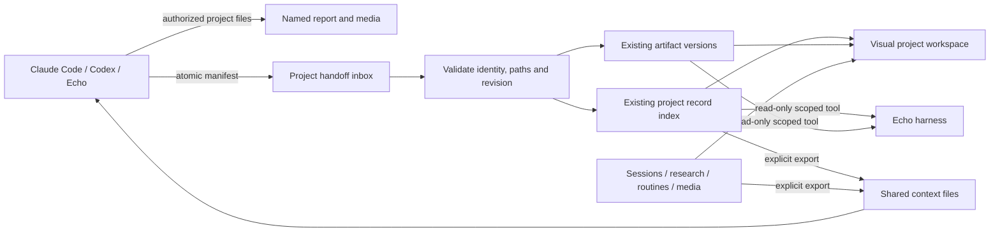

# Visual project workspace: findings and implementation

Baseline: EchoSpeak `b6b9f99`, version 11.7.1. Existing uncommitted desktop build files are outside this change. No version bump, release, model call or active-session restart is part of this work.

## Research evidence

Mr. Mak was inspected at [`94c0d282`](https://github.com/witnesstodark/mr-mak-workspace/tree/94c0d282da48597cde07440bf88e0b1318c6721b), rather than inferred from its README.

* [`src/types.ts`](https://github.com/witnesstodark/mr-mak-workspace/blob/94c0d282da48597cde07440bf88e0b1318c6721b/src/types.ts) defines workspace entities and named report steps. `src/lib/workspace.ts` reads the registry, preserves the last good state after failed reads and refreshes visible views.
* [`src/components/ReportViewer.tsx`](https://github.com/witnesstodark/mr-mak-workspace/blob/94c0d282da48597cde07440bf88e0b1318c6721b/src/components/ReportViewer.tsx) selects Markdown, image or frame rendering. ReportFrame applies the workspace theme. These are native presentation features; they do not establish that an agent's work succeeded.
* [`desktop/service/workspace.mjs`](https://github.com/witnesstodark/mr-mak-workspace/blob/94c0d282da48597cde07440bf88e0b1318c6721b/desktop/service/workspace.mjs) indexes and reads report files with path checks, limits and queued metadata edits.
* Its `AGENTS.md`, `CLAUDE.md` and workspace-authoring skill instruct agents to author reports, register deliverables and preserve revisions. The application does not automatically infer a professional report from every conversation.

EchoSpeak already provides these reusable foundations:

* `apps/backend/agent/projects.py`: persistent project registry, attached folder, project instructions, metadata and atomic JSON writes.
* `agent/state.py`, `agent/threads.py`: existing chat associations and execution records.
* `agent/lean/artifacts.py` and `api/routes/lean.py`: artifact content, revision history and opaque-origin, network-blocked HTML/SVG frames.
* `agent/research_notebook.py`, `api/routes/sessions.py`, `agent/project_context.py`: expiring chat evidence and explicitly saved project findings, separate from personal memory.
* `agent/media_library.py`, `agent/routines.py`: existing project-associated media and routines.
* `apps/web/src/lean/Pages.tsx`, `index.tsx`: project selection currently opens or creates a conversation. Changing this landing action does not require changing session execution.
* `widgets/RichMarkdown.tsx`, `ArtifactPanel.tsx`: existing Markdown, code, table, diagram and artifact renderers.

## External agents

[Codex project instructions](https://developers.openai.com/codex/guides/agents-md) support repository-scoped conventions. [Codex hooks](https://developers.openai.com/codex/hooks) document project/user hooks, trusted project configuration, Stop and Interrupt events. [Legacy notify](https://developers.openai.com/codex/config-advanced#notifications) receives an agent-turn-complete JSON argument. These are notifications about a turn, not independent verification of a task. Support depends on the installed Codex version and host; manually written manifests remain the portable interface.

[Claude Code hooks](https://code.claude.com/docs/en/hooks) document Stop, StopFailure and SessionEnd with JSON on stdin. Stop means the response is ending; StopFailure means an API failure. Neither proves successful implementation. Hooks require deliberate local configuration. Do not replace existing hooks or modify global agent settings automatically.

## Selected architecture

Use `.echospeak/project.json` as an explicit project identity binding and `.echospeak/handoffs/*.json` as a bounded report inbox. Publish manifests atomically. Partial files remain errors for retry; they never remove the last good report. A stable record ID and increasing revision provide idempotency and prevent stale revisions overwriting newer work. Content changes with an unchanged revision are rejected.

Store the small index in dedicated, backwards-compatible fields on the existing project record and document snapshots in the existing artifact store. Dedicated fields avoid replacing unrelated briefs or research when project metadata is updated. Do not add a database, scheduler, permanent-memory channel or agent runtime. Reuse current project associations to show existing artifacts, research, media, sessions, routines and activity. Import only checks associations and file availability; displayed verification remains agent-reported.

Opt-in sharing prepares the project identity and exports approved project context into `.echospeak/context/`. Agents can read these files with their own authorized tools. Echo can read indexed reports with a project-scoped tool. Neither direction starts autonomous work, imports transcripts or shares credentials.

## Trust and scope

Imported content is untrusted evidence. Reading it participates in the existing Rule of Two; it must not become project instructions, learned facts, an approval or a command. Verify any Echo session or artifact association against the selected project. Keep external session identifiers separate from Echo session links.

Resolve references under the attached project root, reject absolute/traversal/secret paths and links out of scope, bound file sizes and scan counts, and never execute imported scripts. Markdown keeps existing safe links and rendering. HTML uses existing sandboxed artifact frames; local raster images may be embedded after the same path checks, while remote network access remains blocked. No allow-same-origin, filesystem URLs or API credentials in frames.

The filesystem convention was chosen over an MCP server or authenticated hook-to-API bridge because it avoids API-key distribution, a running Echo requirement and a new execution authority. Visible-view polling plus explicit sync was chosen over another background watcher. Unopened projects can be synced when opened; this is not a continuous background agent service.

Implementation, verification and manual evaluation details are recorded in `docs/PROJECT_WORKSPACE.md` once the change is complete.

## Engineering result

The selected approach is implemented in source. Existing projects load with empty report indexes and sharing disabled; they do not require a migration or lose their existing associations. No external coding-agent runtime, model dependency, database or scheduler was added.

| Area | Main files | Responsibility |
| --- | --- | --- |
| Registry | `apps/backend/agent/projects.py`, `api/routes/projects.py` | Backwards-compatible workspace fields and serialized project updates |
| Workspace | `apps/backend/agent/project_workspace.py`, `api/routes/project_workspace.py` | Schema, scoped imports, identity/path checks, revision index, sync, previews, context export and native tools |
| Artifact reuse | `apps/backend/agent/lean/artifacts.py` | Existing content versions and sandbox, project provenance, local report images and cached lightweight catalog summaries |
| Harness | `agent/lean/runtime.py`, `toolbox.py`, `policy.py`, `job.py`, `agent/learning/episodes.py` | Offer scoped tools, classify reports as untrusted evidence and exclude report bookkeeping from verification grading |
| UI | `apps/web/src/projects/`, `index.tsx`, `lean/Pages.tsx` | Dedicated workspace landing, rich reports/files, existing resource associations and three-item Show more pattern |
| Rendering | `widgets/RichMarkdown.tsx`, `widgets/RightPanel.tsx` | Reuse Markdown/media rendering and the shared panel without unrelated chat context |
| Portable bridge | `apps/backend/resources/project_handoff.py`, `scripts/project_handoff.py`, desktop backend spec | Atomic file publishing, optional receipt hooks and packaged helper data |
| Documentation | `docs/PROJECT_WORKSPACE.md`, `docs/GUIDE.md` | Schema, configuration examples, diagrams, limits and manual evaluation |

### Verification recorded

* Final focused backend run: **43 passed, 1 skipped** across `test_project_workspace.py` and existing `test_visual_responses.py`. The skipped test requires real symlink-creation permission on Windows. Invalid absolute/traversal/private paths, foreign sessions/artifacts and cross-chat screenshot preservation were tested separately and passed.
* Earlier combined workspace/artifact/scripted-runtime run: **71 passed, 1 skipped**, including `test_lean_runtime.py`. Subsequent workspace additions were checked in the final focused run above; these counts are separate runs, not additive totals.
* Final frontend run: **17 passed** across project references/rendering and existing shared-panel/observation tests. Typecheck and production Vite build passed. The build retains the existing large-chunk warning.
* An isolated localhost API and headless Chromium preview used synthetic project data, without models. Desktop and 390-pixel mobile checks passed for report rendering, source-file navigation, original-image viewing, Escape dismissal, file browsing, no page errors and no horizontal mobile overflow. Both theme appearances were inspected. This checked the workspace component, not a packaged Windows installation or the entire running desktop shell.
* No paid/live model or external-agent tests ran. No user sessions were restarted or interrupted. Hook examples were researched against official documentation and their parser/publisher was tested with fixtures; actual Claude Code/Codex hook configuration remains the owner's manual evaluation.

### Practical limitations

Report import verifies structure, associations and accessible references; it does not run the reported tests or independently certify work. Linked assets retain their current filesystem contents, so revisions should use versioned asset names. Legacy artifacts without project IDs rely on existing session associations. Visible-view sync is intentionally bounded and is not an always-running file watcher. HTML stays within the existing sandbox and cannot depend on external scripts/styles/network access. Installed-app packaging, real model use and independent-agent workflows still need manual evaluation before publishing.
