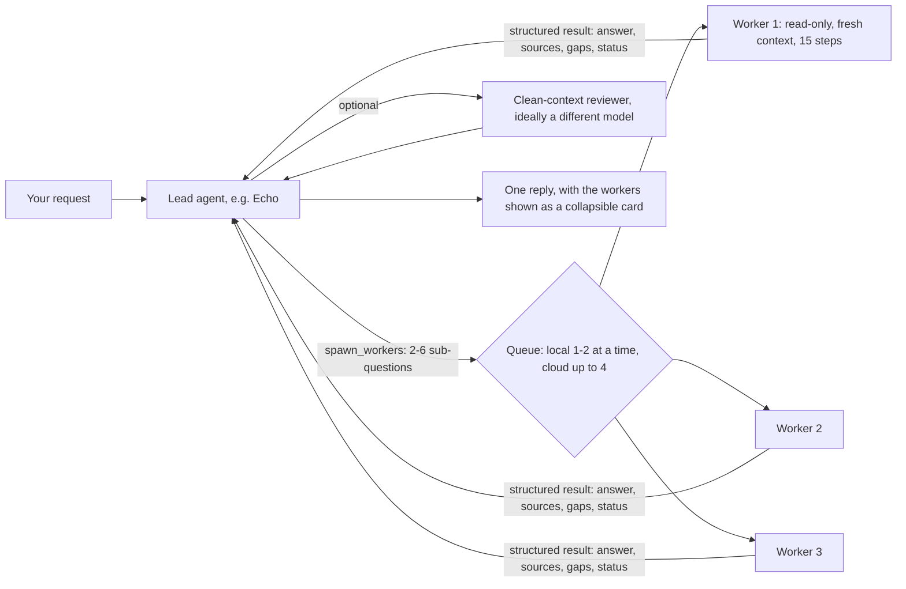

# Agent swarms for EchoSpeak

Date: 2026-10-20. Research and design proposal. Nothing here is implemented yet.

**Question:** should EchoSpeak run "swarms" of agents, how would that fit the current harness, and how would Echo's agents use them?

**Short answer:** yes, but as a narrow feature. The research says the following:
- A lead agent that spawns a few short-lived, **read-only workers** for parallel lookups pays off.
- A crowd of agents debating or writing in parallel usually makes things worse, especially on one local GPU.

## What EchoSpeak already has

| Piece | What it does | Where |
| --- | --- | --- |
| Fixed personas (Echo, Jarvis, Glados, …) | Named agents with their own soul, toolsets and model | `agent/lean/personas.py` |
| Handoff | `delegate_to_agent` runs a teammate with a fresh context. It is sequential and nested (depth 2), with at most 6 handoffs per request | `runtime.py` `_native_tools` |
| Parallel answers | When you @mention 2+ agents that share one model, they answer in parallel, then the lead merges the answers | `runtime.py` `_run_fan_out`, `_merge` |
| Work together | Discussion, then `assign_tasks` puts owned tasks on a board. Owners take turns. `complete_task` and an evidence-based completion check close the job | `runtime.py`, `agent/lean/job.py` |
| Shared safety state | One taint list per request across all agents (Rule of Two). Approvals always go to the owner | `agent/lean/policy.py`, `loop.py` |
| Read-only toolboxes | `Toolbox.restrict_to_read_only()` (used for planning turns) | `agent/lean/toolbox.py` |
| Remote agents | `ask_remote_agent` over signed A2A, with approval each time | `agent/a2a_trust.py` |
| Learning roles | `Episode.role` is `solo`, `lead` or `worker` | `agent/learning/store.py` |

**What's missing:** a lead can't split one request into several **parallel, disposable** sub-tasks. Every helper is a full persona taking a turn in the chat, one after another.

## What the research says

Status: [V] means the research pass opened the primary source; [S] means it relied on snippets or secondary sources. I didn't re-open these sources myself, so treat [S] items as leads.

**Where multi-agent helps:** breadth-first, parallelizable reading.
- Anthropic's research system (Opus lead, Sonnet workers) beat a single agent by 90.2% on their research eval. It used about 15× the tokens of a chat. [V] https://www.anthropic.com/engineering/multi-agent-research-system
- Token spend alone explained about 80% of the performance difference. Much of the gain is simply more compute.

**Where it hurts:** sequential work.
- Google and MIT (180 configurations) measured multi-agent variants losing 39–70% on sequential tasks.
- Independent agents amplified errors 17.2×; with a central orchestrator the amplification was 4.4×.
- Gains turn negative once a single agent already scores about 45%. [S] https://arxiv.org/abs/2512.08296

**With matched compute, one agent is often as good.**
- At equal thinking-token budgets, single agents match or beat multi-agent systems on multi-hop reasoning. [V] https://arxiv.org/abs/2604.02460
- Majority voting explains most of the gains credited to "debate". [S] https://arxiv.org/abs/2508.17536

**Small local models get worse with more copies of themselves.**
- 7B–8B models decline from the second agent onward, and a shared history makes token cost grow quadratically. [V] https://arxiv.org/abs/2606.00655
- Thirty debating 7B–32B agents add no diversity over one. Only *mixing different models* breaks that ceiling. [V] https://arxiv.org/abs/2606.02646

**Practitioners converge on one writer.**
- Cognition (April 2026): writes stay single-threaded; other agents read, review and advise. A clean-context reviewer works. Parallel writing and free-form negotiation fail. [V] https://cognition.com/blog/multi-agents-working
- Claude Code agent teams: 3–5 teammates, separate files, a shared task list with claiming. Messages between agents are untrusted and can't approve anything. [V] https://code.claude.com/docs/en/agent-teams

**Large swarms exist, but on frontier models.**
- Kimi K2.6 uses an RL-trained orchestrator with up to 300 sub-agents (vendor-reported). [S]
- Microsoft's Agensh coordinates 1,024 agents with no orchestrator, using a shared workspace. It reports gains on hard coding benchmarks, gives no cost figures, and is a preprint. [V] https://arxiv.org/abs/2609.26781
- Neither result transfers to a 4B–30B model on one GPU.

**Failure modes are well catalogued.**
- MAST lists 14 failure modes: system design, misalignment between agents, and missing verification. [V] https://arxiv.org/abs/2503.13657
- Prompt injections can spread from agent to agent. [S] https://arxiv.org/abs/2410.07283

## Proposed design: "research swarm" as a tool, not a new kind of chat

### 1. A lead-only tool, `spawn_workers`

- Offered only to the owner's agents in an interactive chat, behind a setting: **Settings › Agent › Research swarm** (off by default until the bench shows it wins).
- Arguments: a list of up to 6 `{goal, expected_output}` items.
- The tool description carries Anthropic's scaling rules:
  - a simple question: no workers;
  - a comparison: 2–4 workers;
  - broad research: up to 6.
- Each worker is an **ephemeral `LeanTurn`**, not a persona:
  - It runs on the lead's model, or a "worker model" setting.
  - It starts with an empty history and a brief stating the objective, output format, tool guidance and boundaries.
  - It reuses `Toolbox.restrict_to_read_only()`. No writes, sends, desktop input, memory saves or handoffs. That is the single-writer rule built in.
  - It gets a step budget (default 15) and a wall-clock timeout, and stops when the lead's request is cancelled.
  - It uses `interactive=False`, so anything needing approval is refused rather than asking you six times.
- Workers share the request's taint list. A worker that read the web taints the whole request, as a handoff does today.
- Concurrency reuses the `_run_fan_out` thread pool. The pool size comes from the endpoint:
  - Local LM Studio or Ollama: 1–2 (KV-cache memory is the limit; Ollama's `OLLAMA_NUM_PARALLEL` × context length).
  - Cloud: up to 4.
  - The rest wait in a queue.

### 2. Results come back as data, not chat

- Each worker returns `{status, answer, sources[], open_questions[]}`:
  - sources come from the shared `research_notebook`, so the lead can re-open them;
  - status is `done`, `partial` or `failed`, judged from the worker's tool records like an episode, not from its own claim.
- Results reach the lead inside `<untrusted-content>` when the worker read outside content. With **Also web pages** on, they pass through the quarantined reader first. This stops an injected instruction from hopping worker → lead.
- The lead synthesizes. It must cite worker sources, not worker opinions.

### 3. Verification instead of debate

- **Optional reviewer:** one more clean-context worker checks the lead's draft against the sources, ideally on a *different* model (a cloud "smart friend" when Private mode allows). Mixing models is the one reliable source of diversity in the research above.
- **Best-of-N for checkable answers** (later): N candidates for a calculation, or code with a test command, keeping the one that passes. Voting beats debate.
- **No debate rounds.** Group chats keep one round of independent proposals, and then the lead decides.

### 4. How the agents would use it

- **Echo** on "compare these 4 laptops": spawns 4 workers, one per laptop (specs, price, reviews), and writes one comparison table with links.
- **Glados** on a code question in a project: 2–3 workers *read* different parts of the repo (file tools are read-only for workers) and report. Glados alone makes the edit and runs the tests.
- **Work together** groups: personas keep their roles. Any persona can spawn workers for its own task, but **only the task owner writes**. Later, the task board becomes a light blackboard: claims, dependencies and findings that workers read as summaries, never as raw transcripts.
- **A2A** (later): a worker slot can be a remote agent, keeping today's approval-every-time rule.

### 5. In the app

- One collapsible "Workers" card under the lead's message. It shows one row per worker with its goal, status, steps, sources and time.
- Workers are not chat members and add no messages. The Timing view shows their spans; the trace for each worker already exists through `tracing`.
- Learning records each worker as an `Episode` with `role="worker"` (the field exists). Lessons stay per persona, so workers read the lead's lessons and never write their own.

### 6. Safety rules (non-negotiable)

- Workers get a **subset** of the lead's permissions, never more. Read-only by default.
- A worker or remote agent can never approve, and its text is never an instruction.
- Workers share the request's taint, and its Rule-of-Two decisions apply to the lead's later actions.
- Budgets live in code:
  - at most 6 workers per call;
  - at most 2 `spawn_workers` calls per request;
  - per-worker steps and timeout;
  - a total token cap per request, shown in the Timing view.

## How we'd know it works

- Add about 20 research and comparison tasks from real use to `scripts/echo_bench.py`.
- Run single-agent against swarm **at matched token budgets** (the condition in arXiv 2604.02460), on one local model and one cloud model.
- Ship the setting on by default only for the combinations where swarm wins on quality per token.
- Expectation from the research: a win on cloud models for broad research, and little or no gain on a single 4B–9B local model.

## Phases

| Phase | Scope | Effort |
| --- | --- | --- |
| 1 | `spawn_workers` (read-only, budgets, queue, structured results, untrusted wrapping), Workers card, worker episodes, bench tasks | M (about a week) |
| 2 | Clean-context reviewer with an optional different model; best-of-N for checkable answers | S–M |
| 3 | Task board as blackboard for Work together (claims, dependencies, summarized findings) | M |
| 4 | Remote A2A agents as worker slots | S once phase 1 exists |

## What not to build

- Parallel writers to the same project.
- Debate rounds between copies of one model.
- Dozens or hundreds of local agents.
- Workers that can approve, or that inherit more than read-only tools.
- A separate "swarm chat" next to group chats.
