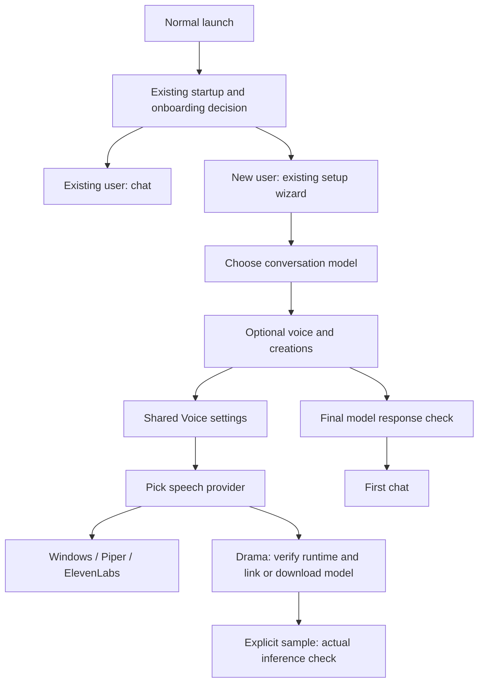

# EchoSpeak 11.9.2: voice and setup audit

This continues the merged 11.9.0 baseline, including all 11.8 harness work. It adds optional speech output, not another reasoning model. A2A architecture changes are reserved for 11.9.3.

## Existing architecture and findings

| Area | Existing system | Finding and change |
| --- | --- | --- |
| Settings | `settings/SettingsPanel.tsx`, shared Group/Row/Select/TextField controls and `useSettings` | Listening and speaking were mixed under Engines; ElevenLabs settings appeared even when a local provider was selected. Speech providers now share one selection and configuration status; only the chosen provider's configuration is expanded. |
| Setup | `setup/FirstRunSetup.tsx`, dedicated desktop setup window, `/onboarding` | Existing installations already skip onboarding. The optional step previously displayed all voice and creation settings at once. It now opens either area on request, then summarizes the voice on the final step. Voice readiness does not gate the first chat. |
| Startup | Desktop backend self-check and existing startup-readiness reporting | No speech model should initialize here. Drama readiness inspects bounded metadata and saved runtime verification, without starting a process or loading weights. Broken optional voice setup remains a Settings problem, not a desktop startup failure. |
| Voice selection | `voice_runtime.default_voice_provider`, saved `voice_local_tts_provider` | Keep this existing setting despite its historical name; it selects Windows, Piper, ElevenLabs or Drama-3. It is independent of the conversation model. |
| Speech jobs | `VoiceJobStore`, `voice_transport` and project-owned media library | Preview and conversation playback use the same synthesis adapter. The governed artifact tool now supports the other implemented TTS adapters as well as Windows speech, with existing authority checks retained. |
| Playback | `LocalVoicePlayback`, existing WAV clip routes and cancellation | Preserve bounded clips and the existing playback queue. Register pending jobs before synthesis, so Stop also covers a model that is still loading. Cancelled work cannot return a successful playback result. |
| Native Live voice | Existing Gemini Live audio path | Native Gemini Live retains its own audio. Standard voice conversations and reply read-aloud use the selected TTS provider. |
| Persona identities | Existing persona and speech transport | There is no validated per-persona TTS identity mapping. This release uses one explicitly selected speech voice, with an optional Drama reference. It does not claim Jarvis/GLaDOS voice replicas or add a second conversation runtime. |

## Verified runtime compatibility

The requested `JarodMica/audio.cpp` repository is a fork. Its checked main revision, `a4a4c07ff9af10c437c777eeabf31677eea62668`, did not contain the Drama-3 backend. The model author's card links to upstream `0xShug0/audio.cpp`, and identifies `e065d66b7aa70bb697e39b1e7a952197f017baef` as a tested Windows CPU/CUDA revision. That is the pinned revision used by managed source builds.

Upstream v0.9.2 published Windows binaries exist, but its source revision `0097d365a00b52a6991ad7618f0a04e8d2935e47` lacks the Drama-3 model spec. Their presence is not evidence of compatibility. EchoSpeak therefore does not automatically install those binaries or pretend that a generic GGUF runtime can run the model.

Runtime verification executes `audiocpp_cli --list-loaders --json` and requires `fish_drama3` with offline `tts`. It also checks `--version` for compiled backends, so choosing CUDA on a CPU-only build is not reported as configured. This proves a loader is present, not that inference succeeds. Changing the executable's path, size or modification time invalidates the saved verification. This is a compatibility check, not publisher signing or protection against a malicious local owner.

## Model feasibility

Pinned model manifest: `Jmica/Drama-3-GGUF`, revision `17a5b40c5dc2c2be986f5371a7e650108b828e29`. File sizes and SHA-256 values were checked against its Hugging Face LFS metadata.

| Profile | Download | Upstream starting CPU-expert layers |
| --- | --- | --- |
| Q2 experts / Q8 backbone | 15.88 GiB | 8 |
| Q3 experts / Q8 backbone | 18.93 GiB | 12 |
| Q4 experts / Q8 backbone | 22.91 GiB | 24 |
| Q4 experts / Q4 backbone | 21.78 GiB | 20 |
| Q4 experts / FP32 routers | 22.97 GiB | 24, conservative starting value |
| Q4 experts / FP32 routers / BF16 head | 23.87 GiB | 24, conservative starting value |

These are large experimental models. File size is not a VRAM estimate. CPU-offloaded experts consume host RAM, dense/audio components still use the chosen backend, references and context add memory, and a local chat model competes for resources. The conversion author's tests used a 96 GiB GPU; physical 16/24 GiB compatibility is not established. The two FP32-profile starting values in EchoSpeak are conservative configuration choices, not published hardware measurements. CPU inference is supported but may be impractically slow for conversational use on some PCs. Windows voices and Piper remain lighter alternatives.

The GGUF carries the tokenizer, codec and model contract. Imports inspect bounded GGUF metadata for `audiocpp.family=fish_drama3`. They link existing files in place, without copying many gigabytes or claiming provenance verification.

## Implementation choice

Upstream supports a reusable HTTP server and streaming speech. Its normal server is not an authenticated EchoSpeak service, and a robust streaming integration needs lifecycle, cancellation and playback work beyond returning WAV files. For this release, a serialized CLI worker fits the existing synthesis boundary and provides hard process cancellation without exposing another listening port.

Each bounded speech request starts one native worker, writes a WAV and exits. Memory is released afterward. Windows jobs own the process tree with kill-on-close; stopping work or losing the backend releases owned workers. This deliberately trades warm-model latency for predictable resource ownership. It does not provide token-by-token/PCM streaming. Long replies reload between existing playback clips, so Drama is an optional quality/experimentation path rather than a promised realtime replacement.

Only owner setup actions may choose an executable, link a model, start a source build or begin a download. Agent tool arguments cannot select native executables, model paths or arbitrary CLI flags. An existing trusted build can be imported, or Settings can build the pinned upstream source when Git, Visual Studio C++ tools, CMake and Ninja are available. CUDA also requires its toolkit. EchoSpeak does not automatically install a developer toolchain or NVIDIA drivers.

## Data flow



```mermaid
sequenceDiagram
  actor User
  participant UI as Chat / voice / preview
  participant Voice as Existing voice runtime and jobs
  participant Worker as Owned audio.cpp CLI
  participant Player as Existing WAV playback
  User->>UI: Read aloud / Play sample
  UI->>Voice: Selected speech provider and bounded text
  Voice->>Voice: Validate provider, scope and cancellation
  Voice->>Worker: Verified local model, CPU/CUDA, optional reference
  Worker-->>Voice: WAV file
  Voice->>Voice: Validate clip and cancellation again
  Voice-->>Player: Existing authenticated audio route / preview response
  Player-->>User: Speech
  User->>Voice: Stop while preparing or playing
  Voice->>Worker: Cancel owned process tree
  Voice->>Voice: Preserve cancelled job; discard late output
```

## Security, licensing and recovery

* Downloads use fixed model URLs, pinned sizes and SHA-256 digests. The existing resumable downloader is shared with a separate progress dictionary and cancellation event, so voice installation cannot cancel a creation install. Partial files are retained after interruption; completed files are verified before activation.
* Existing download privacy gates apply before model and runtime installation. Local synthesis works without a network adapter; it creates no HTTP listener. Native process network behavior is outside Python's network audit backstop, as for existing local tools.
* Reference WAVs must be local, uncompressed PCM, at most 30 seconds and 5 MiB, with a matching transcript. URLs, UNC paths and mapped network drives are rejected. References are not copied into project reports, model downloads or cloud requests. No emotional directions are added automatically.
* Native children receive the shared stripped environment, including removal of the ElevenLabs API key. Workers use no shell and no visible console. Only owned worker trees are stopped; existing app sessions and external runtimes are not restarted.
* **Built with Fish Audio.** Drama-3 has the Fish Audio Community License v1.0, not EchoSpeak's MIT license. Its commercial, hosted-service and voice-use conditions require review. Setup links the pinned terms and requires acceptance for downloads/imports. The full license and conversion notice ship as resources and accompany managed model downloads. audio.cpp itself is Apache 2.0; its source checkout retains its own notices.
* Missing model/runtime, unsupported loader, bad WAV, memory failure and timeouts return actionable voice errors. They do not block normal chat. Cancelling preview or conversation playback releases the Drama worker. Setup does not resume automatically on launch; Resume is explicit.

## What is not claimed

No Drama model was downloaded or inferred during development. No paid voice/model API, active application session or real voice reference was used. Source/fixture checks cannot establish naturalness, latency, GPU fit, voice similarity or end-to-end installed behavior. Managed compilation requires owner validation on the target Windows toolchain. Full PCM streaming, a warm persistent speech server, automatic emotional tagging and distinct persona voice assignments remain outside this release.

## Modified areas

Backend: `agent/drama_voice.py`, `voice_runtime.py`, `voice_transport.py`, `generation_setup.py`, `child_env.py`, `api/routes/media_runtime.py`, `config.py`, bundled license resources and focused tests. Frontend: shared voice Settings, preview cleanup, settings refresh, optional setup and summary, with existing theme tokens. Release metadata, guide, changelog and release notes are updated to 11.9.2. No A2A implementation changes are included.

## Primary references

* [Model card and hardware caveats](https://huggingface.co/Jmica/Drama-3-GGUF)
* [Pinned model files](https://huggingface.co/Jmica/Drama-3-GGUF/tree/17a5b40c5dc2c2be986f5371a7e650108b828e29)
* [Verified upstream Drama documentation](https://github.com/0xShug0/audio.cpp/blob/e065d66b7aa70bb697e39b1e7a952197f017baef/docs/models/fish_drama3.md)
* [CLI contract](https://github.com/0xShug0/audio.cpp/blob/e065d66b7aa70bb697e39b1e7a952197f017baef/app/cli/main.cpp)
* [HTTP server and streaming](https://github.com/0xShug0/audio.cpp/blob/e065d66b7aa70bb697e39b1e7a952197f017baef/app/server/README.md)
* [Model license](https://huggingface.co/Jmica/Drama-3-GGUF/blob/17a5b40c5dc2c2be986f5371a7e650108b828e29/LICENSE)
